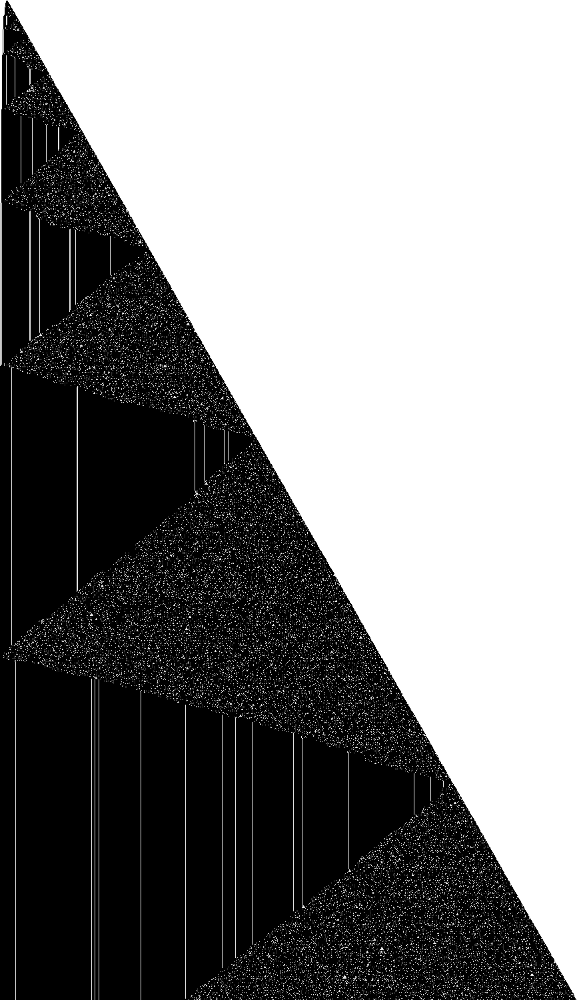

# 1RB---_0RC1RD_1LA0LA_1LE0RB_1LF1LE_1LC0LD

bbchallenge id 50114. One of the six-state holdouts whose halting from blank tape is open. Group G01.
**Family:** Chaotic one-dimensional cellular automaton in growing bursts ("chaotic 1dCA in bell").

| state | read 0 | read 1 |
|---|---|---|
| A | 1RB | --- |
| B | 0RC | 1RD |
| C | 1LA | 0LA |
| D | 1LE | 0RB |
| E | 1LF | 1LE |
| F | 1LC | 0LD |

## What it does

The question is open. Between visits of the head the tape is a word over the two letters `1` and `10` (no two 0s side by side). Each sweep acts on it like one generation of a cellular automaton whose patterns look random. The run proceeds in waves: a chaotic region spreads from the left end across the whole tape and freezes behind a slower front; each wave starts with three quick bursts of growth at the left end. Successive waves take about 3.06 times longer. The bbchallenge wiki lists it as "chaotic 1dCA in bell"; the same table started in states C, D, E, F is four other holdouts.

### A cellular automaton in waves



One row every 6 visits of the head to the right end, in state B (time runs down), 3.8·10^7 steps; dark where the tape differs from itself 4 cells further. Speckled triangles are the chaotic waves, vertical lines the frozen pattern they leave.

Whenever the head reaches the right end, the tape contains no `00` (except next to the head): it is a sequence of the letters `1` and `10`. The head crosses runs of 1s quickly and does real work only at the 0s, so a sweep acts like one generation of a cellular automaton on this sequence, and the patterns it makes look random.

The run goes in waves. A chaotic region (the speckled triangles) starts at the left end and spreads right to the growing end of the tape; behind it a front moves right and leaves a frozen pattern (vertical lines). Each wave begins when the left end grows in three quick bursts; the next wave starts before the front of the previous one has reached the right end. Each wave lasts about 3.06 times as long as the previous one:

| wave starts at step | ratio |
|---|---|
| 643294 | – |
| 2108809 | 3.28 |
| 6495092 | 3.08 |
| 20126119 | 3.10 |
| 60650898 | 3.01 |
| 187352297 | 3.09 |
| 570905460 | 3.05 |
| 1767969175 | 3.10 |

A halt needs A to read a 1, which in practice means the right content arriving at the left end. With chaotic content, a halt would be a matter of chance per wave; since waves grow geometrically, even a likely halt could come impossibly late.

## What is established

| level | claim | where |
|---|---|---|
| kernel | **The halting configurations.** The machine stops exactly when it reads the symbol of a halting transition (A1); the generated statement covers every configuration. | `step_none_iff`, `lean/Blank.lean` |
| kernel | **No halt in the first 10,000 steps.** The list simulator of the shared library, proved to agree with the machine's semantics, runs 10,000 steps from blank tape without a halt, evaluated by Lean's kernel. | `blank_runs_kernel`, `lean/Blank.lean` |
| native | **No halt in the first 10^7 steps.** The same run, evaluated by compiled code. | `blank_runs_native`, `lean/Blank.lean` |
| trusted | **No halt in the first 10^9 steps.** The C simulator `tools/c/triage.c` runs 10^9 steps without a halt; at the end 53,911 cells have been visited and 42,422 of them hold a 1. | `holdouts/triage.json` |
| kernel | **The sweeps cross blocks of ones.** C crosses `1^n` to the right in 3n steps (carrying the 0 behind it), E crosses it to the left in n steps: only the isolated 0s take work. | `c_sweep`, `e_sweep`, `lean/Rules.lean` |
| trusted | **No 00 inside the tape.** At all 25,729 visits of the head to the right end in state B up to 3·10^8 steps, the tape has no two adjacent 0s outside its last three cells: it is a word over `1` and `10`. | snapshots, `py/sweeps.py` |
| trusted | **Waves about 3.06 times longer each.** The left end grows in triples of bursts that start at steps 643294, 2108809, 6495092, 20126119, 60650898, 187352297, 570905460, 1767969175: ratios 3.28, 3.08, 3.10, 3.01, 3.09, 3.05, 3.10. The tape width at those moments grows by about 1.75 = √3.06 each time. | `py/analyse.py records` |
| trusted | **Same table, other start states.** Started in C, D, E or F (and renamed to normal form) this table is the holdout 1RB0RB_1LC---_0LA1LD_1RE0LC_1RF1RE_1RA0RD, 1RB0LF_1RC1RB_1RD0RA_1RE0RE_1LF---_0LD1LA, 1RB1RA_1RC0RF_1RD0RD_1LE---_0LC1LF_1RA0LE or 1RB0RE_1RC0RC_1LD---_0LB1LE_1RF0LD_1RA1RF; the wiki notes that they all behave alike. | relabelling check; wiki.bbchallenge.org |
| heuristic | **Halting looks like a matter of chance.** Each wave ends with the chaotic content reaching the left end, where a halt (A reading 1) could happen. If the content arriving there were random with a fixed small chance p per wave of being a halting one, the machine would halt after about 1/p waves, i.e. after roughly 3.06^1/p steps: a halt would be likely eventually but unobservably late. Whether any reachable left-end content halts is not known. | reasoning from the wave structure |
| heuristic | **Growth shape: exp/sqrt.** Left of the start, the visited part of the tape grows like the logarithm of the step count: each new cell costs a roughly constant factor more time, the signature of a counter or of a Collatz-like map whose values are written on the tape (fitted exponent 0.07). Right of the start it grows like the square root of the step count, the signature of a head sweeping back and forth across the whole tape and adding a cell or a few at the end of each sweep (a bouncer-like shape) (fitted exponent 0.503). | `tools/py/bbtools/triage.py` |
| open | **Does it halt from blank tape?.** Not known. Next step: Extract the cellular automaton (the map from the word over {1, 10} before a sweep to the word after), then study the left-end boundary rule: which contents can make A read 1 there. | README.md, Further work |

Levels: kernel = checked by Lean's kernel; native = Lean with `native_decide`; trusted = a computation in this repository (C or Python) that is not formally verified; heuristic = an argument or an observation of pictures, not a proof.

## Further work

Extract the cellular automaton (the map from the word over {1, 10} before a sweep to the word after), then study the left-end boundary rule: which contents can make A read 1 there.

## First look

Growth class **exp/sqrt** (left: exp, exponent 0.07; right: sqrt,
exponent 0.503). After 1,000,000,000 steps: 53,911 cells visited (151 left of the
start, 35,882 right), 42,422 ones.

- left, step 570,905,460: `E>0 1 0 1^11 0 1^11 0 1^3 0 1^11 0 1^3 0 1^15 0 1^7 0 1^3 0 1^31 0 1^15 0 1^3 0 1^7 0 1^7 0 1^11 0 1^3 0 1^23 0 1^3 0 1^3 0 1^3 0 1^15 0 1^3 0 1^3 0 1^39 0 1^3 0 1^23 0 1^23 0 1^3 0 1^3 0 1^3 0 1^11 0 1^3 0 1^3 0 1^11 0 1^7 0 1^11 0 1^3 0 1^3 0 1^7 0 1^19 0 1^15 0 1^7 0 1^7 0 1^3 0 1^11 0 1^11 0 1^3`
- right, step 969,896,874: `1^2 0 1 0 1 0 1^3 0 1^3 0 1^3 0 1^3 0 1^3 0 1^5 0 1 0 1^3 0 1^5 0 1 0 1^3 0 1^3 0 1^3 0 1^5 0 1 0 1^3 0 1^3 0 1^3 0 1 0 1^7 0 1^5 0 1 0 1^3 0 1^3 0 1^5 0 1 0 1^3 0 1^3 0 1 0 1^5 0 1^5 0 1^5 0 1^5 0 1^5 0 1^7 0 1^5 0 1 0 1^5 0 1 0 1^3 0 1^5 0 1 0 1^3 0 1 0 1^7 0 1^5 0 1 0 1 0 1^5 0 1^9 0 1 0 1 0 1 0 `
- right, step 985,582,099: `1^2 0 1 0 1 0 1^3 0 1^3 0 1^3 0 1^3 0 1^3 0 1^5 0 1 0 1^3 0 1^5 0 1 0 1^3 0 1^3 0 1^3 0 1^5 0 1 0 1^3 0 1^3 0 1^3 0 1 0 1^7 0 1^5 0 1 0 1^3 0 1^3 0 1^5 0 1 0 1^3 0 1^3 0 1 0 1^5 0 1^5 0 1^5 0 1^5 0 1^5 0 1^7 0 1^5 0 1 0 1^5 0 1 0 1^3 0 1^5 0 1 0 1^3 0 1 0 1^7 0 1^5 0 1 0 1 0 1^5 0 1^9 0 1 0 1 0 1 0 `

## Files

- `lean/Rules.lean`: the shift rules, generated by `py/rules.py` with `bbtools.symtm.prove` (shared helper: `holdouts/1RB0LB_1RC0LA_1RD---_0RE1LD_1LF0RF_1LA1RB/py/sweeps.py`).
- `py/analyse.py image`: the defect picture `pages/holdouts/1RB---_0RC1RD_1LA0LA_1LE0RB_1LF1LE_1LC0LD/defects.png`; `py/analyse.py records`: the bursts of growth at the slow end (up to 3·10^9 steps, several minutes).

## Files

- `lean/Rules.lean`: the shift rules, generated by `py/rules.py` with `bbtools.symtm.prove` (shared helper: `holdouts/1RB0LB_1RC0LA_1RD---_0RE1LD_1LF0RF_1LA1RB/py/sweeps.py`).
- `py/analyse.py image`: the defect picture `pages/holdouts/1RB---_0RC1RD_1LA0LA_1LE0RB_1LF1LE_1LC0LD/defects.png`; `py/analyse.py records`: the bursts of growth at the slow end (up to 3·10^9 steps, several minutes).

## Deciders tried (F11, 13 November 2026)

None closes. Each reaches a halting configuration in its abstraction, which says nothing about halting.

- n-gram CPS (`tools/c/ngramcps.c`), equal widths on both sides: a halting local configuration is reached with plain up to width 18, history 1 up to width 18, history 2 up to width 16, history 3 up to width 15, LRU history up to width 3 (larger widths ran out of the 150 s or 60 million configuration budget).
- n-gram CPS with every cell tagged by its position mod p: fails for p = 2 up to width 16, p = 3 up to width 16, p = 4 up to width 16, p = 6 up to width 16.
- n-gram CPS where each side also carries the state of a small automaton that has read that side from the far end (every automaton with up to 3 states on both sides, or 4 states on one side), with position mod 1..4 and widths 4, 6, 8: no closed set without a halt in all 120 parameter sets.
- Run-length windows (the K nearest runs of equal macro cells on each side, run lengths kept exactly below T and mod M above): fails for all 72 parameter sets (cells of 1 to 4 bits, K = 2, 4, 6, T = 2, 4, M = 1, 2, 4).
- Two-automaton closed tape language by SAT (a deterministic automaton reading each side inward, n states each, CaDiCaL): no solution for n = 2..7; n = 8 not finished in 150 s.

## Where a halt can come from

`lean/Route.lean` (kernel, written by `py/route.py`): `halt_route`, two steps before any halt the machine is in one
of: F with 1 two left, 0 under the head.

## Pages

- [`pages/holdouts/1RB---_0RC1RD_1LA0LA_1LE0RB_1LF1LE_1LC0LD/explainer.html`](../../pages/holdouts/1RB---_0RC1RD_1LA0LA_1LE0RB_1LF1LE_1LC0LD/explainer.html)
- [`pages/holdouts/1RB---_0RC1RD_1LA0LA_1LE0RB_1LF1LE_1LC0LD/proof-status.html`](../../pages/holdouts/1RB---_0RC1RD_1LA0LA_1LE0RB_1LF1LE_1LC0LD/proof-status.html)

## Check

```sh
. /etc/profile.d/lean.sh && holdouts/1RB---_0RC1RD_1LA0LA_1LE0RB_1LF1LE_1LC0LD/lean/check.sh
python3 holdouts/1RB---_0RC1RD_1LA0LA_1LE0RB_1LF1LE_1LC0LD/py/rules.py && git diff --exit-code holdouts/1RB---_0RC1RD_1LA0LA_1LE0RB_1LF1LE_1LC0LD/lean/Rules.lean
```

<!-- related machines: written by holdouts/related.py -->

## Related machines

Other holdouts of the list of 608 that are tied to this one. The comparison of tables is exact; everything about runs was checked on the first 10^7 steps of each machine and is an observation, not a proof (`holdouts/related.py`, `holdouts/related.json`).

**Same table as the machines below, started in another state.** Renaming the states as shown turns this machine's table into the other one, the halting transition included. The other machine starts in its own state A, which is not this machine's A: its run from blank tape is the run of this table started in another state. These are different runs: in the first 10^7 steps of each, no configuration of this machine's run occurs in any of the others, even up to a shift of the tape. So each of these holdouts is its own halting question, and settling one does not settle another.

- [`1RB0RE_1RC0RC_1LD---_0LB1LE_1RF0LD_1RA1RF`](../1RB0RE_1RC0RC_1LD---_0LB1LE_1RF0LD_1RA1RF/README.md): rename A→C, B→D, C→B, D→E, E→F, F→A and exchange left and right; it is this table started in state F, in a mirror
- [`1RB0RB_1LC---_0LA1LD_1RE0LC_1RF1RE_1RA0RD`](../1RB0RB_1LC---_0LA1LD_1RE0LC_1RF1RE_1RA0RD/README.md): rename A→B, B→C, C→A, D→D, E→E, F→F and exchange left and right; it is this table started in state C, in a mirror
- [`1RB0LF_1RC1RB_1RD0RA_1RE0RE_1LF---_0LD1LA`](../1RB0LF_1RC1RB_1RD0RA_1RE0RE_1LF---_0LD1LA/README.md): rename A→E, B→F, C→D, D→A, E→B, F→C and exchange left and right; it is this table started in state D, in a mirror
- [`1RB1RA_1RC0RF_1RD0RD_1LE---_0LC1LF_1RA0LE`](../1RB1RA_1RC0RF_1RD0RD_1LE---_0LC1LF_1RA0LE/README.md): rename A→D, B→E, C→C, D→F, E→A, F→B and exchange left and right; it is this table started in state E, in a mirror

<!-- end of related machines -->
