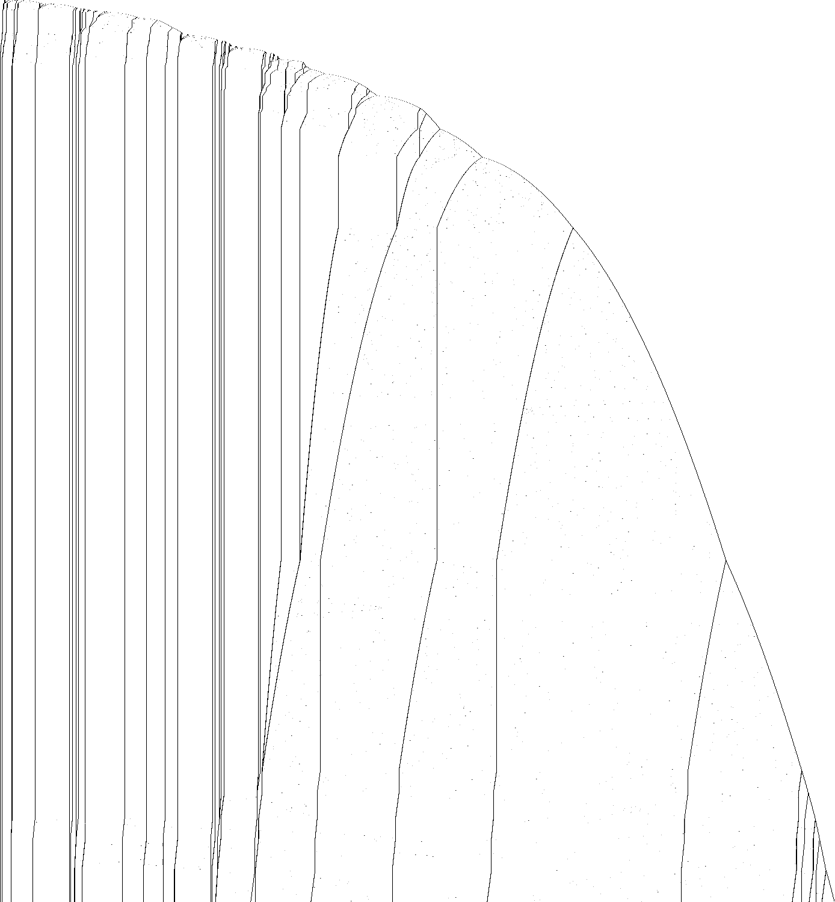

# 1RB---_1RC0RA_1LD0RB_0LE0LC_1RE1LF_0RD0RB

bbchallenge id 108865. One of the six-state holdouts whose halting from blank tape is open. Group G01.
**Family:** Signals on a list of (01)^n blocks: markers 0, 00, 10, 110 travel through the list and shift block lengths (mirror pair).

| state | read 0 | read 1 |
|---|---|---|
| A | 1RB | --- |
| B | 1RC | 0RA |
| C | 1LD | 0RB |
| D | 0LE | 0LC |
| E | 1RE | 1LF |
| F | 0RD | 0RB |

## What it does

**The question is open.** The tape is a list of blocks `(01)^n` separated by single 0s, with a few markers (`00`, `10`, `110`). The head sweeps over the list and the right end grows by about one block per sweep; markers travel through the list, each passage changing the lengths of the blocks it crosses by small amounts (±1, ±2 early on, ±15, ±30, ±90 later), while the blocks at the other end freeze. It is the mirror image of `1RB0LE_0RC0RA_1LC1RD_0LB0LE_1LA0LF_1LE---` with another start state. The shift rules over the background are proved in Lean; no macro map is known yet.



Defect picture of the first 3·10^7 steps (time runs down, rows at equal step spacing; dark where the periodic background breaks); made with `c/st.c` and `py/img.py` of the shared folder, see Reproduce.

### Equivalence

`1RB---_1RC0RA_1LD0RB_0LE0LC_1RE1LF_0RD0RB` and `1RB0LE_0RC0RA_1LC1RD_0LB0LE_1LA0LF_1LE---` are mirror images of each other up to the start state: reflecting the tape and renaming
M1's states A,B,C,D,E,F to F,E,A,B,C,D turns M1 into M2, but M2 starts in the state that is C in M1. The two
blank-tape runs are therefore different orbits of one rule table (they do not meet in the first 2·10^4 steps); the
behaviour is the same and is described once here. Another machine with the same transition graph and another start
state is in another group's folder: `1RB0RF_1LC0RA_0LD0LB_1RD1LE_0RC0RA_1RA---` (G10).

### The list

At the moments the head reaches the growing (right) end the tape reads, for M1 (state C at the right end),

    10 01^17 0 01^68 00 01^177 0 01^293 00 01^19 0 01^430 0 01^78 0 01^200 10 01^64 0 01^803 ... 0 01^536 0 01^1910 C>0

(step 299,990,880): blocks `(01)^n` separated by single 0s, with markers `00`, `10` and `110` in place of some
separators. The part next to the fixed end is frozen; in the active zone the markers move by about a block per sweep
and the blocks around them change by multiples of 15 (±15, ±30, ±90); the last block grows by one copy per sweep.
Early on (to about 2·10^6 steps) the changes are −1/+2/−2/+2 on alternate passes, with all signs flipping when the
first block is absorbed at the end wall.

### Halting

M1 halts on reading 1 in state A; M2 on reading 1 in state F, the mirror image of the same transition. In M1, A
crosses the background reading only 0s (`A> (01)^n` → `(10)^n A>`, proved), so a halt needs A to arrive at a marker
in the wrong phase (mirrored for M2); no such configuration has been seen.

## What is established

| level | claim | where |
|---|---|---|
| kernel | **The halting configurations.** The machine stops exactly when it reads the symbol of a halting transition (A1); the generated statement covers every configuration. | `step_none_iff`, `lean/Blank.lean` |
| kernel | **No halt in the first 10,000 steps.** The list simulator of the shared library, proved to agree with the machine's semantics, runs 10,000 steps from blank tape without a halt, evaluated by Lean's kernel. | `blank_runs_kernel`, `lean/Blank.lean` |
| native | **No halt in the first 10^7 steps.** The same run, evaluated by compiled code. | `blank_runs_native`, `lean/Blank.lean` |
| trusted | **No halt in the first 10^9 steps.** The C simulator `tools/c/triage.c` runs 10^9 steps without a halt; at the end 139,537 cells have been visited and 69,737 of them hold a 1. | `holdouts/triage.json` |
| heuristic | **Growth shape: exp/sqrt.** Left of the start, the visited part of the tape grows like the logarithm of the step count: each new cell costs a roughly constant factor more time, the signature of a *counter* or of a Collatz-like map whose values are written on the tape (fitted exponent 0.095). Right of the start it grows like the square root of the step count, the signature of a head sweeping back and forth across the whole tape and adding a cell or a few at the end of each sweep (a *bouncer*-like shape) (fitted exponent 0.517). | `tools/py/bbtools/triage.py` |
| kernel | **Shift rules over the (01) background.** How the head crosses `(01)^n` and `(10)^n` in each direction, for every n (2n steps each). | `lean/Rules.lean` |
| trusted | **No halt in the first 10^11 steps.** A plain C simulator (`longrun.c`, on `tools/c/tm.h`) runs 10^11 steps from blank tape without a halt; at the end the head has visited cells -296 to 856,865 and 428,540 cells hold a 1. | `holdouts/1RB---_1RC0RA_1LD0RB_0LE0LC_1RE1LF_0RD0RB/c/longrun.c` |
| trusted | **Same rule table as 1RB0LE_0RC0RA_1LC1RD_0LB0LE_1LA0LF_1LE---.** Reflecting the tape and renaming the states turns this machine into `1RB0LE_0RC0RA_1LC1RD_0LB0LE_1LA0LF_1LE---`; this machine starts in the state that corresponds to F there. The two runs from blank tape are different orbits of the same rule table (they do not meet in the first 2·10^4 steps), with the same kind of behaviour. | README.md |
| heuristic | **Frozen list, active front.** In the defect picture the walls far from the growing end stop moving while new ones are born at that end and slow down as they move inward. This is the shape of a counter-like process, with no visible drift toward a halting configuration. | the picture `defects.png` |
| open | **Does it halt from blank tape?** Not known. The marker dynamics on the list has not been reduced to a map. | README.md, Further work |

Levels: kernel = checked by Lean's kernel; native = Lean with `native_decide`; trusted = a computation in this repository (C or Python) that is not formally verified; heuristic = an argument or an observation, not a proof.

## Further work

Reduce the marker dynamics to a rule on the block list: which marker a sweep creates at the growing end, how a marker changes the blocks it passes, and when it freezes. With that, a list-level simulator would reach far beyond 10^11 steps and show whether a marker can ever meet A (M2: F) in the halting phase.

## Files

- `lean/Rules.lean`: shift rules over the (01) background, generated by `py/gen_rules.py` (`bbtools.symtm.prove` through `holdouts/1RB---_1RC0RA_1LD0RB_0LE0LC_1RE1LF_0RD0RB/py/rulegen.py`).
- Shared tools of this worker's six G01 machines, in `holdouts/1RB---_1RC0RA_1LD0RB_0LE0LC_1RE1LF_0RD0RB/`: `py/rulegen.py` (symbolic runs and Lean rule files on top of `bbtools.symtm`), `c/evw.c` (the tape at every visit of the head to one end, as runs of given words; `TAPE=...` starts from a constructed tape), `c/longrun.c` (plain direct simulation), `c/st.c` + `py/img.py` (the defect picture).

## Deep exact run

No halt in the first 1.23x10^18 steps: the macro simulator `holdouts/1RB0LB_1RC0LA_1LB0RD_1RE1RD_1RB1RF_1LA---/c/msim.c` with blocks of 4 cells ran
from blank tape to step 1,237,211,225,275,426,962. It is exact, and at this block size it agrees with the
direct simulator after 2,000,014,148 steps (`python3 holdouts/1RB0LB_1RC0LA_1LB0RD_1RE1RD_1RB1RF_1LA---/py/deep.py run 240`, then `verify`).

## Pages

- [`pages/holdouts/1RB---_1RC0RA_1LD0RB_0LE0LC_1RE1LF_0RD0RB/explainer.html`](../../pages/holdouts/1RB---_1RC0RA_1LD0RB_0LE0LC_1RE1LF_0RD0RB/explainer.html)
- [`pages/holdouts/1RB---_1RC0RA_1LD0RB_0LE0LC_1RE1LF_0RD0RB/proof-status.html`](../../pages/holdouts/1RB---_1RC0RA_1LD0RB_0LE0LC_1RE1LF_0RD0RB/proof-status.html)

## Reproduce

```sh
. /etc/profile.d/lean.sh      # after scripts/setup-lean.sh
holdouts/1RB---_1RC0RA_1LD0RB_0LE0LC_1RE1LF_0RD0RB/lean/check.sh
gcc -O2 -o triage tools/c/triage.c && ./triage 1RB---_1RC0RA_1LD0RB_0LE0LC_1RE1LF_0RD0RB 1000000000
python3 holdouts/1RB---_1RC0RA_1LD0RB_0LE0LC_1RE1LF_0RD0RB/py/gen_rules.py      # rewrites lean/Rules.lean
gcc -O2 -o evw holdouts/1RB---_1RC0RA_1LD0RB_0LE0LC_1RE1LF_0RD0RB/c/evw.c && ./evw 1RB---_1RC0RA_1LD0RB_0LE0LC_1RE1LF_0RD0RB 1000000000 C R 01,10 | less -S   # the tape at each visit
gcc -O2 -o longrun holdouts/1RB---_1RC0RA_1LD0RB_0LE0LC_1RE1LF_0RD0RB/c/longrun.c && ./longrun 1RB---_1RC0RA_1LD0RB_0LE0LC_1RE1LF_0RD0RB 100000000000   # 15-40 min
gcc -O2 -o st holdouts/1RB---_1RC0RA_1LD0RB_0LE0LC_1RE1LF_0RD0RB/c/st.c && ./st 1RB---_1RC0RA_1LD0RB_0LE0LC_1RE1LF_0RD0RB 30000000 1500 st.pgm && python3 holdouts/1RB---_1RC0RA_1LD0RB_0LE0LC_1RE1LF_0RD0RB/py/img.py st.pgm pages/holdouts/1RB---_1RC0RA_1LD0RB_0LE0LC_1RE1LF_0RD0RB/defects.png 1400 1500 2
```

<!-- related machines: written by holdouts/related.py -->

## Related machines

Other holdouts of the list of 608 that are tied to this one. The comparison of tables is exact; everything about runs was checked on the first 10^7 steps of each machine and is an observation, not a proof (`holdouts/related.py`, `holdouts/related.json`).

**Same table as the machines below, started in another state.** Renaming the states as shown turns this machine's table into the other one, the halting transition included. The other machine starts in its own state A, which is not this machine's A: its run from blank tape is the run of this table started in another state. These are different runs: in the first 10^7 steps of each, no configuration of this machine's run occurs in any of the others, even up to a shift of the tape. So each of these holdouts is its own halting question, and settling one does not settle another.

- [`1RB0LE_0RC0RA_1LC1RD_0LB0LE_1LA0LF_1LE---`](../1RB0LE_0RC0RA_1LC1RD_0LB0LE_1LA0LF_1LE---/README.md): rename A→F, B→E, C→A, D→B, E→C, F→D and exchange left and right; it is this table started in state C, in a mirror
- [`1RB0RF_1LC0RA_0LD0LB_1RD1LE_0RC0RA_1RA---`](../1RB0RF_1LC0RA_0LD0LB_1RD1LE_0RC0RA_1RA---/README.md): rename A→F, B→A, C→B, D→C, E→D, F→E; it is this table started in state B

<!-- end of related machines -->
