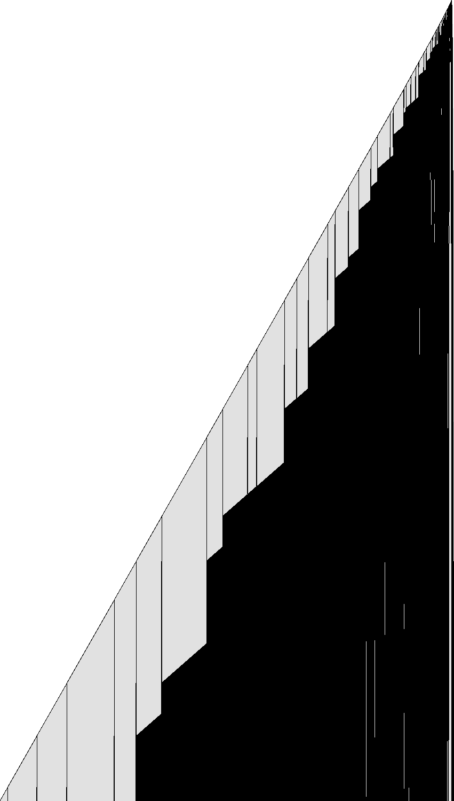

# 1RB0LA_0LC0RA_1LA1LD_1LC0LE_1RF0LF_0RB---

bbchallenge id 69753. One of the six-state holdouts whose halting from blank tape is open. Group G01.
**Family:** Domain builder: a block of ones at the fast end frozen into ever longer domains.

| state | read 0 | read 1 |
|---|---|---|
| A | 1RB | 0LA |
| B | 0LC | 0RA |
| C | 1LA | 1LD |
| D | 1LC | 0LE |
| E | 1RF | 0LF |
| F | 0RB | --- |

## What it does

The question is open. The tape is a sequence of domains, each a periodic pattern (mostly built from `10`, `0111` and blocks of 1s), separated by walls that barely move. At the left end a block of 1s grows by about two cells per visit of the head until it is frozen into a domain of `10`s, and a new block starts. The right end grows by one cell at rare events (62 in 3·10^9 steps). No macro map is known.

### Domains and walls



One row every 2 visits of the head to the left end, in state E (time runs down), 6·10^7 steps; grey where the tape repeats with period 4, dark where it does not. Vertical lines are walls between domains.

The tape is made of stretches of different repeating patterns (domains) separated by walls that stay in place. At the left end, a block of 1s grows by about two cells per visit of the head; at some moment the whole block is turned into a domain of `10`s (the grey wedges) and a new block starts. The domains are then rewritten by later sweeps into other patterns (dark), while their walls stay put. The right end grows by one cell at rare events.

A halt needs F reading 1; no candidate configuration has been seen. What triggers the freezing of the block, and what the domains encode, is the next thing to find.

## What is established

| level | claim | where |
|---|---|---|
| kernel | **The halting configurations.** The machine stops exactly when it reads the symbol of a halting transition (F1); the generated statement covers every configuration. | `step_none_iff`, `lean/Blank.lean` |
| kernel | **No halt in the first 10,000 steps.** The list simulator of the shared library, proved to agree with the machine's semantics, runs 10,000 steps from blank tape without a halt, evaluated by Lean's kernel. | `blank_runs_kernel`, `lean/Blank.lean` |
| native | **No halt in the first 10^7 steps.** The same run, evaluated by compiled code. | `blank_runs_native`, `lean/Blank.lean` |
| trusted | **No halt in the first 10^9 steps.** The C simulator `tools/c/triage.c` runs 10^9 steps without a halt; at the end 49,910 cells have been visited and 35,869 of them hold a 1. | `holdouts/triage.json` |
| kernel | **Sweeps over 10s.** B crosses `(10)^n` to the right in 2n steps, turning it into `(01)^n`; C crosses it to the left with a 1 ahead in 2n steps, turning it into ones. | `b_shift`, `c_fill`, `lean/Rules.lean` |
| trusted | **Rare events at the right end.** Up to 3·10^9 steps the right end grows 62 times (at 9176, 13365, 18394, …, 2173474752, 2810209489), and its position moves from 42 to 70 cells right of the start between 7.6·10^6 and 1.9·10^9 steps. | `py/analyse.py records` |
| heuristic | **Domains with frozen walls.** In the defect picture (period 4) the tape is cut into regions by vertical, i.e. stationary, walls; new regions are born at the left end with lengths that grow from one to the next. | the picture `pages/holdouts/1RB0LA_0LC0RA_1LA1LD_1LC0LE_1RF0LF_0RB---/defects.png` |
| heuristic | **Growth shape: exp/sqrt.** Left of the start, the visited part of the tape grows like the square root of the step count, the signature of a head sweeping back and forth across the whole tape and adding a cell or a few at the end of each sweep (a bouncer-like shape) (fitted exponent 0.512). Right of the start it grows like the logarithm of the step count: each new cell costs a roughly constant factor more time, the signature of a counter or of a Collatz-like map whose values are written on the tape (fitted exponent 0.09). | `tools/py/bbtools/triage.py` |
| open | **Does it halt from blank tape?.** Not known. Next step: Find what freezes the left block (a signal from the right end?), the sequence of block lengths, and the rewriting rules of the domains; then accelerate by domain events. | README.md, Further work |

Levels: kernel = checked by Lean's kernel; native = Lean with `native_decide`; trusted = a computation in this repository (C or Python) that is not formally verified; heuristic = an argument or an observation of pictures, not a proof.

## Further work

Find what freezes the left block (a signal from the right end?), the sequence of block lengths, and the rewriting rules of the domains; then accelerate by domain events.

## First look

Growth class **exp/sqrt** (left: sqrt, exponent 0.512; right: exp,
exponent 0.09). After 1,000,000,000 steps: 49,910 cells visited (36,650 left of the
start, 65 right), 35,869 ones.

- left, step 971,487,092: `D>0 1^2367 0 1 0 1 0 1 0 1 0 1 0 1 0 1 0 1 0 1 0 1 0 1 0 1 0 1 0 1 0 1 0 1 0 1 0 1 0 1 0 1 0 1 0 1 0 1 0 1 0 1 0 1 0 1 0 1 0 1 0 1 0 1 0 1 0 1 0 1 0 1 0 1 0 1 0 1 0 1 0 1 0 1 0 1 0 1 0 1 0 1 0 1 0 1 0 1 0 1 0 1 0 1 0 1 0 1 0 1 0 1 0 1 0 1 0 1 0 1 0 1 0 1 0 1 0 1 0 1 0 1 0 1 0 1 0 1 0 1 0 1 0 1 0 1 0`
- left, step 987,131,016: `D>0 1^3139 0 1 0 1 0 1 0 1 0 1 0 1 0 1 0 1 0 1 0 1 0 1 0 1 0 1 0 1 0 1 0 1 0 1 0 1 0 1 0 1 0 1 0 1 0 1 0 1 0 1 0 1 0 1 0 1 0 1 0 1 0 1 0 1 0 1 0 1 0 1 0 1 0 1 0 1 0 1 0 1 0 1 0 1 0 1 0 1 0 1 0 1 0 1 0 1 0 1 0 1 0 1 0 1 0 1 0 1 0 1 0 1 0 1 0 1 0 1 0 1 0 1 0 1 0 1 0 1 0 1 0 1 0 1 0 1 0 1 0 1 0 1 0 1 0`
- right, step 832,367,993: `1 0 1 0 1 0 1 0 1 0 1 0 1 0 1 0 1 0 1 0 1 0 1 0 1 0 1 0 1 0 1 0 1 0 1 0 1 0 1 0 1 0 1 0 1 0 1 0 1 0 1 0 1 0 1 0 1 0 1 0 1 0 1 0 1 0 1 0 1 0 1 0 1 0 1 0 1 0 1 0 1 0 1 0 1 0 1 0 1 0 1 0 1 0 1 0 1 0 1 0 1 0 1 0 1 0 1 0 1 0 1 0 1 0 1 0 1 0 1 0 1 0 1 0 1 0 1 0 1 0 1 0 1 0 1 0 1 0 1 0 1 0 1 0 1 0 1 0 1 0 `
- right, step 920,769,226: `1 0 1 0 1 0 1 0 1 0 1 0 1 0 1 0 1 0 1 0 1 0 1 0 1 0 1 0 1 0 1 0 1 0 1 0 1 0 1 0 1 0 1 0 1 0 1 0 1 0 1 0 1 0 1 0 1 0 1 0 1 0 1 0 1 0 1 0 1 0 1 0 1 0 1 0 1 0 1 0 1 0 1 0 1 0 1 0 1 0 1 0 1 0 1 0 1 0 1 0 1 0 1 0 1 0 1 0 1 0 1 0 1 0 1 0 1 0 1 0 1 0 1 0 1 0 1 0 1 0 1 0 1 0 1 0 1 0 1 0 1 0 1 0 1 0 1 0 1 0 `

## Files

- `lean/Rules.lean`: the shift rules, generated by `py/rules.py` with `bbtools.symtm.prove` (shared helper: `holdouts/1RB0LB_1RC0LA_1RD---_0RE1LD_1LF0RF_1LA1RB/py/sweeps.py`).
- `py/analyse.py image`: the defect picture `pages/holdouts/1RB0LA_0LC0RA_1LA1LD_1LC0LE_1RF0LF_0RB---/defects.png`; `py/analyse.py records`: the bursts of growth at the slow end (up to 3·10^9 steps, several minutes).

## Files

- `lean/Rules.lean`: the shift rules, generated by `py/rules.py` with `bbtools.symtm.prove` (shared helper: `holdouts/1RB0LB_1RC0LA_1RD---_0RE1LD_1LF0RF_1LA1RB/py/sweeps.py`).
- `py/analyse.py image`: the defect picture `pages/holdouts/1RB0LA_0LC0RA_1LA1LD_1LC0LE_1RF0LF_0RB---/defects.png`; `py/analyse.py records`: the bursts of growth at the slow end (up to 3·10^9 steps, several minutes).

## Deciders tried (F11, 13 November 2026)

None closes. Each reaches a halting configuration in its abstraction, which says nothing about halting.

- n-gram CPS (`tools/c/ngramcps.c`), equal widths on both sides: a halting local configuration is reached with plain up to width 24, history 1 up to width 24, history 2 up to width 24, history 3 up to width 24, LRU history up to width 24 (larger widths ran out of the 150 s or 60 million configuration budget).
- n-gram CPS with every cell tagged by its position mod p: fails for p = 2 up to width 20, p = 3 up to width 20, p = 4 up to width 20, p = 6 up to width 20.
- n-gram CPS where each side also carries the state of a small automaton that has read that side from the far end (every automaton with up to 3 states on both sides, or 4 states on one side), with position mod 1..4 and widths 4, 6, 8: no closed set without a halt in all 120 parameter sets.
- Run-length windows (the K nearest runs of equal macro cells on each side, run lengths kept exactly below T and mod M above): fails for all 72 parameter sets (cells of 1 to 4 bits, K = 2, 4, 6, T = 2, 4, M = 1, 2, 4).
- Two-automaton closed tape language by SAT (a deterministic automaton reading each side inward, n states each, CaDiCaL): no solution for n = 2..7; n = 8 not finished in 150 s.

## Where a halt can come from

`lean/Route.lean` (kernel, written by `py/route.py`): `halt_route`, two steps before any halt the machine is in one
of: D with 1 two left, 1 left, 1 under the head.

## Pages

- [`pages/holdouts/1RB0LA_0LC0RA_1LA1LD_1LC0LE_1RF0LF_0RB---/explainer.html`](../../pages/holdouts/1RB0LA_0LC0RA_1LA1LD_1LC0LE_1RF0LF_0RB---/explainer.html)
- [`pages/holdouts/1RB0LA_0LC0RA_1LA1LD_1LC0LE_1RF0LF_0RB---/proof-status.html`](../../pages/holdouts/1RB0LA_0LC0RA_1LA1LD_1LC0LE_1RF0LF_0RB---/proof-status.html)

## Check

```sh
. /etc/profile.d/lean.sh && holdouts/1RB0LA_0LC0RA_1LA1LD_1LC0LE_1RF0LF_0RB---/lean/check.sh
python3 holdouts/1RB0LA_0LC0RA_1LA1LD_1LC0LE_1RF0LF_0RB---/py/rules.py && git diff --exit-code holdouts/1RB0LA_0LC0RA_1LA1LD_1LC0LE_1RF0LF_0RB---/lean/Rules.lean
```
