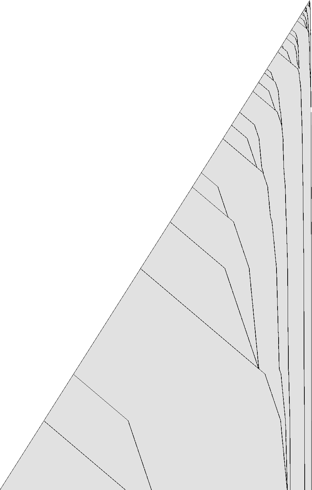

# 1RB0LB_1RC0LA_1RD---_0RE1LD_1LF0RF_1LA1RB

bbchallenge id 3389. One of the six-state holdouts whose halting from blank tape is open. Group G01.
**Family:** Glider collider: a bouncer whose background carries gliders, with a counter at the slow end.

| state | read 0 | read 1 |
|---|---|---|
| A | 1RB | 0LB |
| B | 1RC | 0LA |
| C | 1RD | --- |
| D | 0RE | 1LD |
| E | 1LF | 0RF |
| F | 1LA | 1RB |

## What it does

The question is open. The head shuttles out from the left end over a periodic background, rewriting the word `1^8 00` as `(011)^3 0` on the way right and back on the way left (shift rules proved in Lean). It turns back at the first defect of the background or passes it, depending on the defect's current shape, so the defects work like the digits of a counter, and the far right end is reached only when all of them let the head through. The defects also move, as gliders between a glider gun at the left end and a slowly growing structure at the right end. No map between macro configurations is known yet, so neither halting nor non-halting is in reach.

### A word rewritten on every sweep

Apart from a few defects the tape is one word repeated. When the head has just come back to the left end, the word is `1111111100` (eight 1s, two 0s). Sweeping right, the head turns each copy into `0110110110`, i.e. `(011)^3 0`, 3 steps a cell; sweeping left, it turns them back, 3.8 steps a cell. So the tape flips between two phases, and a sweep costs time proportional to its length.

| sweep | word crossed | word left behind | steps per word |
|---|---|---|---|
| right, state E | `1^5 00 1^3` | `1100110110` | 30 |
| left, state A | `(011)^3 0` | `1^4 00 1^4` | 38 |

Each return of the head to the left end adds two cells there (a word every five returns), so the left side grows like the square root of the time.

### Gliders between a gun and a pile



One row every 7 returns of the head to the left end (time runs down), 4·10^8 steps; dark where the tape differs from itself 10 cells further, i.e. where the background is broken. The upper-left edge is the left end of the tape.

A defect in the background is not static: every sweep reshapes it (it cycles through about seven shapes such as `1^4 00 1^12`, `1^20`, `1^4 0^4 1^4`) and moves it. These moving defects are gliders, the dark lines in the picture.

1. Now and then the right end of the tape grows by 3 or 4 cells (a burst).
1. Within one excursion of the head the left end reacts: it shows `0^5 1^6` and a new glider is born.
1. The glider moves right, at first fast, then slower; gliders that meet merge into one.
1. Merged gliders pile up near the right end, and the next burst follows.

The bursts get rarer as the tape gets longer (33 in 3·10^9 steps, the last at 1.26·10^9), so the right side grows like a logarithm.

Defects as digits. The head does not cross the whole tape every time. Leaving the left end it crosses the background up to the first defect, and there it either turns back or passes, depending on the defect's shape, which changes at every visit. Around 2·10^8 steps the first defect lets the head through on 2 of every 7 visits (the excursions follow the pattern long, short, long, short, short, short, short), so the second defect is visited 7/2 times less often, and so on: the defects form a counter, and the right end, reached only when every defect lets the head through, moves at the rate of the counter's overflows.

### Halting needs a defect at the left end

The only halting transition is C reading 1. C is entered when B reads a 0 and writes a 1 moving right, so a halt needs `B>0 1`: in the background the cell after such a 0 is always 0, so the halt can only come from a defect at the turning point. All gliders seen move away from the left end, so there is no visible path to a halt, but the collision rules have not been worked out, so nothing is proved either way.

The same table, mirrored and started in another state, is the holdout 1RB0LB_1RC1LD_1LD0RD_1LE0RC_1LF---_0LA1RF, which shows the same gliders.

## What is established

| level | claim | where |
|---|---|---|
| kernel | **The halting configurations.** The machine stops exactly when it reads the symbol of a halting transition (C1); the generated statement covers every configuration. | `step_none_iff`, `lean/Blank.lean` |
| kernel | **No halt in the first 10,000 steps.** The list simulator of the shared library, proved to agree with the machine's semantics, runs 10,000 steps from blank tape without a halt, evaluated by Lean's kernel. | `blank_runs_kernel`, `lean/Blank.lean` |
| native | **No halt in the first 10^7 steps.** The same run, evaluated by compiled code. | `blank_runs_native`, `lean/Blank.lean` |
| trusted | **No halt in the first 10^9 steps.** The C simulator `tools/c/triage.c` runs 10^9 steps without a halt; at the end 32,978 cells have been visited and 22,841 of them hold a 1. | `holdouts/triage.json` |
| kernel | **The two sweeps over the background.** Going right, E crosses `(1^5 00 1^3)^n` in 30n steps and leaves `(1100110110)^n`, a rotation of `(011)^3 0`; going left, A crosses `((011)^3 0)^n` in 38n steps and leaves `(1^4 00 1^4)^n`. At the left end, `A> 0^3 1^2 0^2 (1^8 00)^(n+1)` turns and crosses all n+1 words to the right in 30n+49 steps. | `e_sweep`, `a_sweep`, `left_end`, `lean/Rules.lean` |
| trusted | **The right end grows in rare events.** Up to 3·10^9 steps the right end of the tape grows in 33 short bursts after the start-up (at steps 3029, 7914, 14085, 27710, …, 536503257, 802505958, 1259208777), each adding 3 or 4 cells with the same local pattern (`…(011)^5 E>00` then `F>000`, `E>1100`); between 1.26·10^9 and 3·10^9 there is none. | `py/analyse.py records` |
| trusted | **Each right-end event makes the left end emit a glider.** The left end shows the shape `0^5 1^6`, the birth of a new glider, shortly (one excursion of the head) after every one of the 33 bursts (the delay grows from 218 to 135818 steps); 41 births up to 1.26·10^9 steps, so a few births come without a burst. | `py/sweeps.py`, the defect view |
| trusted | **Defects act as the digits of a counter.** Between consecutive returns of the head to the left end (state A), near 2·10^8 steps, the head turns back at the first defect, about 9,300 cells out, on 5 of every 7 excursions and passes it on 2 (pattern long, short, short, short, short, long, short, repeating). | `py/analyse.py excursions` |
| heuristic | **Gliders, merges and a counter.** In the defect picture gliders leave the left end, travel right at about 0.4 words per return of the head to the left end, slow down, merge with each other and pile up as nearly stationary defects some 50–400 words from the right end. The time between bursts grows irregularly (ratios 1.1 to 2.5), which is why the right side grows like a logarithm while the left grows like a square root. | the picture `pages/holdouts/1RB0LB_1RC0LA_1RD---_0RE1LD_1LF0RF_1LA1RB/defects.png` |
| heuristic | **Where a halt would come from.** The machine halts only on C reading 1, i.e. after B reads a 0 that has a 1 just right of it. Normally this never happens in the background; it needs an unusual defect to reach the left end, where the head turns. All gliders seen so far move away from the left end. No probability estimate is attempted: the defects do not look random, and their interactions have not been catalogued. | `step_none_iff` (kernel) and observation |
| heuristic | **Growth shape: exp/sqrt.** Left of the start, the visited part of the tape grows like the square root of the step count, the signature of a head sweeping back and forth across the whole tape and adding a cell or a few at the end of each sweep (a bouncer-like shape) (fitted exponent 0.473). Right of the start it grows like the logarithm of the step count: each new cell costs a roughly constant factor more time, the signature of a counter or of a Collatz-like map whose values are written on the tape (fitted exponent 0.077). | `tools/py/bbtools/triage.py` |
| open | **Does it halt from blank tape?.** Not known. Next step: Catalogue the glider shapes and their speeds, the merge rules, the reaction of the left end to an arriving signal and of the right end to an arriving glider; with that catalogue the run becomes a particle system that a program can accelerate (one step per glider event instead of per sweep), and the question becomes whether a defect of the right shape can ever reach the left end. | README.md, Further work |

Levels: kernel = checked by Lean's kernel; native = Lean with `native_decide`; trusted = a computation in this repository (C or Python) that is not formally verified; heuristic = an argument or an observation of pictures, not a proof.

## Further work

Catalogue the glider shapes and their speeds, the merge rules, the reaction of the left end to an arriving signal and of the right end to an arriving glider; with that catalogue the run becomes a particle system that a program can accelerate (one step per glider event instead of per sweep), and the question becomes whether a defect of the right shape can ever reach the left end.

## First look

Growth class **exp/sqrt** (left: sqrt, exponent 0.473; right: exp,
exponent 0.077). After 1,000,000,000 steps: 32,978 cells visited (23,720 left of the
start, 133 right), 22,841 ones.

- left, step 971,123,408: `A>0 0^2 1^2 0^2 1^8 0^2 1^8 0^2 1^8 0^2 1^8 0^2 1^8 0^2 1^8 0^2 1^8 0^2 1^8 0^2 1^8 0^2 1^8 0^2 1^8 0^2 1^8 0^2 1^8 0^2 1^8 0^2 1^8 0^2 1^8 0^2 1^8 0^2 1^8 0^2 1^8 0^2 1^8 0^2 1^8 0^2 1^8 0^2 1^8 0^2 1^8 0^2 1^8 0^2 1^8 0^2 1^8 0^2 1^8 0^2 1^8 0^2 1^8 0^2 1^8 0^2 1^8 0^2 1^8 0^2 1^8 0^2 1^8 0^2 1^8 `
- left, step 986,770,586: `A>0 0^2 1^2 0^2 1^8 0^2 1^8 0^2 1^8 0^2 1^8 0^2 1^8 0^2 1^8 0^2 1^8 0^2 1^8 0^2 1^8 0^2 1^8 0^2 1^8 0^2 1^8 0^2 1^8 0^2 1^8 0^2 1^8 0^2 1^8 0^2 1^8 0^2 1^8 0^2 1^8 0^2 1^8 0^2 1^8 0^2 1^8 0^2 1^8 0^2 1^8 0^2 1^8 0^2 1^8 0^2 1^8 0^2 1^8 0^2 1^8 0^2 1^8 0^2 1^8 0^2 1^8 0^2 1^8 0^2 1^8 0^2 1^8 0^2 1^8 `
- right, step 536,503,257: `0 1^2 0^2 1^2 0 1^2 0 1^2 0^2 1^2 0 1^2 0 1^2 0^2 1^2 0 1^2 0 1^2 0^2 1^2 0 1^2 0 1^2 0^2 1^2 0 1^2 0 1^2 0^2 1^2 0 1^2 0 1^2 0^2 1^2 0 1^2 0 1^2 0^2 1^2 0 1^2 0 1^2 0^2 1^2 0 1^2 0 1^2 0^2 1^2 0 1^2 0 1^2 0^2 1^2 0 1^2 0 1^2 0^2 1^2 0 1^2 0 1^2 0^2 1^2 0 1^2 0 1^2 0^2 1^2 0 1^2 0 1^2 0^2 1^2 0 1^2 `
- right, step 802,505,958: `0 1^2 0^2 1^2 0 1^2 0 1^2 0^2 1^2 0 1^2 0 1^2 0^2 1^2 0 1^2 0 1^2 0^2 1^2 0 1^2 0 1^2 0^2 1^2 0 1^2 0 1^2 0^2 1^2 0 1^2 0 1^2 0^2 1^2 0 1^2 0 1^2 0^2 1^2 0 1^2 0 1^2 0^2 1^2 0 1^2 0 1^2 0^2 1^2 0 1^2 0 1^2 0^2 1^2 0 1^2 0 1^2 0^2 1^2 0 1^2 0 1^2 0^2 1^2 0 1^2 0 1^2 0^2 1^2 0 1^2 0 1^2 0^2 1^2 0 1^2 `

## Files

- `lean/Rules.lean`: the shift rules, generated by `py/rules.py` with `bbtools.symtm.prove` (shared helper: `holdouts/1RB0LB_1RC0LA_1RD---_0RE1LD_1LF0RF_1LA1RB/py/sweeps.py`).
- `py/analyse.py image`: the defect picture `pages/holdouts/1RB0LB_1RC0LA_1RD---_0RE1LD_1LF0RF_1LA1RB/defects.png`; `py/analyse.py records`: the bursts of growth at the slow end (up to 3·10^9 steps, several minutes).
- `c/snap.c`, `py/sweeps.py`: the snapshot simulator and helpers shared by the six G01 machines studied together (see the docstring of `sweeps.py`).

## Files

- `lean/Rules.lean`: the shift rules, generated by `py/rules.py` with `bbtools.symtm.prove` (shared helper: `holdouts/1RB0LB_1RC0LA_1RD---_0RE1LD_1LF0RF_1LA1RB/py/sweeps.py`).
- `py/analyse.py image`: the defect picture `pages/holdouts/1RB0LB_1RC0LA_1RD---_0RE1LD_1LF0RF_1LA1RB/defects.png`; `py/analyse.py records`: the bursts of growth at the slow end (up to 3·10^9 steps, several minutes).
- `c/snap.c`, `py/sweeps.py`: the snapshot simulator and helpers shared by the six G01 machines studied together (see the docstring of `sweeps.py`).

## Deep exact run

No halt in the first 8.12x10^19 steps: the macro simulator `holdouts/1RB0LB_1RC0LA_1LB0RD_1RE1RD_1RB1RF_1LA---/c/msim.c` with blocks of 10 cells ran
from blank tape to step 81,296,466,142,732,374,722. It is exact, and at this block size it agrees with the
direct simulator after 2,000,097,599 steps (`python3 holdouts/1RB0LB_1RC0LA_1LB0RD_1RE1RD_1RB1RF_1LA---/py/deep.py run 240`, then `verify`).

## Pages

- [`pages/holdouts/1RB0LB_1RC0LA_1RD---_0RE1LD_1LF0RF_1LA1RB/explainer.html`](../../pages/holdouts/1RB0LB_1RC0LA_1RD---_0RE1LD_1LF0RF_1LA1RB/explainer.html)
- [`pages/holdouts/1RB0LB_1RC0LA_1RD---_0RE1LD_1LF0RF_1LA1RB/proof-status.html`](../../pages/holdouts/1RB0LB_1RC0LA_1RD---_0RE1LD_1LF0RF_1LA1RB/proof-status.html)

## Check

```sh
. /etc/profile.d/lean.sh && holdouts/1RB0LB_1RC0LA_1RD---_0RE1LD_1LF0RF_1LA1RB/lean/check.sh
python3 holdouts/1RB0LB_1RC0LA_1RD---_0RE1LD_1LF0RF_1LA1RB/py/rules.py && git diff --exit-code holdouts/1RB0LB_1RC0LA_1RD---_0RE1LD_1LF0RF_1LA1RB/lean/Rules.lean
```

<!-- related machines: written by holdouts/related.py -->

## Related machines

Other holdouts of the list of 608 that are tied to this one. The comparison of tables is exact; everything about runs was checked on the first 10^7 steps of each machine and is an observation, not a proof (`holdouts/related.py`, `holdouts/related.json`).

**Same table as the machine below, started in another state.** Renaming the states as shown turns this machine's table into the other one, the halting transition included. The other machine starts in its own state A, which is not this machine's A: its run from blank tape is the run of this table started in another state. These are different runs: in the first 10^7 steps of each, no configuration of this machine's run occurs in the other, even up to a shift of the tape. So each of these holdouts is its own halting question, and settling one does not settle another.

- [`1RB0LB_1RC1LD_1LD0RD_1LE0RC_1LF---_0LA1RF`](../1RB0LB_1RC1LD_1LD0RD_1LE0RC_1LF---_0LA1RF/README.md): rename A→C, B→D, C→E, D→F, E→A, F→B and exchange left and right; it is this table started in state E, in a mirror

<!-- end of related machines -->
