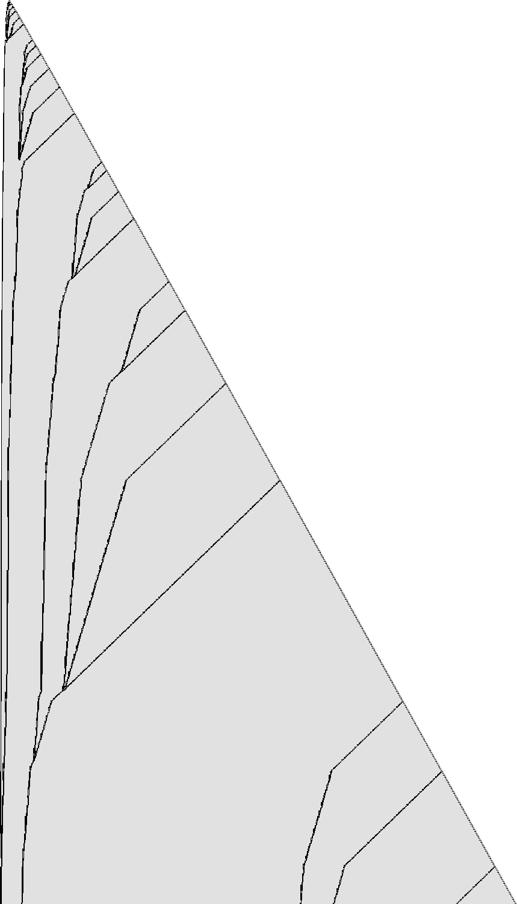

# 1RB0LB_1RC1LD_1LD0RD_1LE0RC_1LF---_0LA1RF

bbchallenge id 66567. One of the six-state holdouts whose halting from blank tape is open. Group G01.
**Family:** Glider collider (mirror image of 1RB0LB_1RC0LA_1RD---_0RE1LD_1LF0RF_1LA1RB, other start state).

| state | read 0 | read 1 |
|---|---|---|
| A | 1RB | 0LB |
| B | 1RC | 1LD |
| C | 1LD | 0RD |
| D | 1LE | 0RC |
| E | 1LF | --- |
| F | 0LA | 1RF |

## What it does

The question is open. The transition table is the mirror image of the holdout 1RB0LB_1RC0LA_1RD---_0RE1LD_1LF0RF_1LA1RB's with the states renamed (A,B,C,D,E,F of that machine are C,D,E,F,A,B here), so the run is that machine's dynamics started in its state E. It shows the same glider system, mirrored: a gun at the right end, a slowly growing structure at the left end.

### The same table, seen in a mirror and started in another state

Swap left and right in the table of 1RB0LB_1RC0LA_1RD---_0RE1LD_1LF0RF_1LA1RB and rename its states A,B,C,D,E,F as C,D,E,F,A,B: you get exactly this table. The only difference is where the run starts: this machine starts in the state that the other calls E. So everything about the background and the gliders carries over, mirrored; the particular sequence of gliders does not.

| sweep | word crossed | word left behind | steps per word |
|---|---|---|---|
| left, state B | `1^8 00` | `(011)^3 0` | 30 |
| right, state D | `(011)^3 0` | `1^4 00 1^4` | 38 |

### Gliders from right to left



One row every 5 visits of the head to the right end (time runs down), 2.8·10^7 steps; dark where the background of period 10 is broken.

As in the mirrored machine, the head shuttles out from the right end and turns back at a defect or passes it depending on the defect's shape, so the defects act as the digits of a counter. The right end (the fast-growing side) is a glider gun; the gliders drift left, merge, and accumulate near the left end, which grows by a few cells in rare bursts (33 in 3·10^9 steps). A halt (E reading 1) needs a defect of the right shape where the head turns.

## What is established

| level | claim | where |
|---|---|---|
| kernel | **The halting configurations.** The machine stops exactly when it reads the symbol of a halting transition (E1); the generated statement covers every configuration. | `step_none_iff`, `lean/Blank.lean` |
| kernel | **No halt in the first 10,000 steps.** The list simulator of the shared library, proved to agree with the machine's semantics, runs 10,000 steps from blank tape without a halt, evaluated by Lean's kernel. | `blank_runs_kernel`, `lean/Blank.lean` |
| native | **No halt in the first 10^7 steps.** The same run, evaluated by compiled code. | `blank_runs_native`, `lean/Blank.lean` |
| trusted | **No halt in the first 10^9 steps.** The C simulator `tools/c/triage.c` runs 10^9 steps without a halt; at the end 31,456 cells have been visited and 23,567 of them hold a 1. | `holdouts/triage.json` |
| trusted | **Same table as 1RB0LB_1RC0LA_1RD---_0RE1LD_1LF0RF_1LA1RB, mirrored.** Mirror the moves of 1RB0LB_1RC0LA_1RD---_0RE1LD_1LF0RF_1LA1RB and rename its states A→C, B→D, C→E, D→F, E→A, F→B: the result is this table. Only the start state differs (this machine starts where the other would be in E). | `py/mirror.py` |
| kernel | **The two sweeps over the background.** Going left, B crosses `(1^8 00)^n` in 30n steps and leaves `((011)^3 0)^n`; going right, D crosses `((011)^3 0)^n` in 38n steps and leaves `(1^4 00 1^4)^n`. | `b_sweep`, `d_sweep`, `lean/Rules.lean` |
| trusted | **The left end grows in rare events.** Up to 3·10^9 steps the left end grows in 33 bursts (at steps 5230, 11061, 24512, …, 854869638, 1183687075, 1640256864). | `py/analyse.py records` |
| heuristic | **Gliders, merges and a counter.** The defect picture is the mirror image of the other machine's: gliders are born at the right end, travel left, merge and pile up near the left end. | the picture `pages/holdouts/1RB0LB_1RC1LD_1LD0RD_1LE0RC_1LF---_0LA1RF/defects.png` |
| heuristic | **Growth shape: exp/sqrt.** Left of the start, the visited part of the tape grows like the logarithm of the step count: each new cell costs a roughly constant factor more time, the signature of a counter or of a Collatz-like map whose values are written on the tape (fitted exponent 0.113). Right of the start it grows like the square root of the step count, the signature of a head sweeping back and forth across the whole tape and adding a cell or a few at the end of each sweep (a bouncer-like shape) (fitted exponent 0.552). | `tools/py/bbtools/triage.py` |
| open | **Does it halt from blank tape?.** Not known. Next step: Analyse 1RB0LB_1RC0LA_1RD---_0RE1LD_1LF0RF_1LA1RB first; the glider catalogue and its rules carry over by the mirror symmetry. | README.md, Further work |

Levels: kernel = checked by Lean's kernel; native = Lean with `native_decide`; trusted = a computation in this repository (C or Python) that is not formally verified; heuristic = an argument or an observation of pictures, not a proof.

## Further work

Analyse 1RB0LB_1RC0LA_1RD---_0RE1LD_1LF0RF_1LA1RB first; the glider catalogue and its rules carry over by the mirror symmetry.

## First look

Growth class **exp/sqrt** (left: exp, exponent 0.113; right: sqrt,
exponent 0.552). After 1,000,000,000 steps: 31,456 cells visited (125 left of the
start, 24,470 right), 23,567 ones.

- left, step 854,869,638: `A>0 0 1^2 0 1^2 0 1^2 0 1^2 0 1^2 0 1^2 0 1^2 0 1^2 0 1^2 0^2 1^2 0 1^2 0 1^2 0^2 1^2 0 1^2 0 1^2 0^2 1^2 0 1^2 0 1^2 0^2 1^2 0 1^2 0 1^2 0^2 1^2 0 1^2 0 1^2 0^2 1^2 0 1^2 0 1^2 0^2 1^2 0 1^2 0 1^2 0^2 1^2 0 1^2 0 1^2 0^2 1^2 0 1^2 0 1^2 0^2 1^2 0 1^2 0 1^2 0^2 1^2 0 1^2 0 1^2 0^2 1^2 0 1^2 0 1^2 0^`
- right, step 971,272,534: `1^4 0^2 1^4 0^2 1^12 0^2 1^8 0^2 1^8 0^2 1^8 0^2 1^8 0^2 1^8 0^2 1^8 0^2 1^8 0^2 1^8 0^2 1^8 0^2 1^8 0^2 1^8 0^2 1^8 0^2 1^8 0^2 1^8 0^2 1^8 0^2 1^8 0^2 1^8 0^2 1^8 0^2 1^8 0^2 1^8 0^2 1^8 0^2 1^8 0^2 1^8 0^2 1^8 0^2 1^8 0^2 1^8 0^2 1^8 0^2 1^8 0^2 1^8 0^2 1^8 0^2 1^8 0^2 1^8 0^2 1^8 0^2 1^8 0^2 1^8`
- right, step 986,940,630: `1^4 0^2 1^4 0^2 1^12 0^2 1^8 0^2 1^8 0^2 1^8 0^2 1^8 0^2 1^8 0^2 1^8 0^2 1^8 0^2 1^8 0^2 1^8 0^2 1^8 0^2 1^8 0^2 1^8 0^2 1^8 0^2 1^8 0^2 1^8 0^2 1^8 0^2 1^8 0^2 1^8 0^2 1^8 0^2 1^8 0^2 1^8 0^2 1^8 0^2 1^8 0^2 1^8 0^2 1^8 0^2 1^8 0^2 1^8 0^2 1^8 0^2 1^8 0^2 1^8 0^2 1^8 0^2 1^8 0^2 1^8 0^2 1^8 0^2 1^8`

## Files

- `lean/Rules.lean`: the shift rules, generated by `py/rules.py` with `bbtools.symtm.prove` (shared helper: `holdouts/1RB0LB_1RC0LA_1RD---_0RE1LD_1LF0RF_1LA1RB/py/sweeps.py`).
- `py/analyse.py image`: the defect picture `pages/holdouts/1RB0LB_1RC1LD_1LD0RD_1LE0RC_1LF---_0LA1RF/defects.png`; `py/analyse.py records`: the bursts of growth at the slow end (up to 3·10^9 steps, several minutes).
- `py/mirror.py`: checks that the table is the mirror image of 1RB0LB_1RC0LA_1RD---_0RE1LD_1LF0RF_1LA1RB's.

## Files

- `lean/Rules.lean`: the shift rules, generated by `py/rules.py` with `bbtools.symtm.prove` (shared helper: `holdouts/1RB0LB_1RC0LA_1RD---_0RE1LD_1LF0RF_1LA1RB/py/sweeps.py`).
- `py/analyse.py image`: the defect picture `pages/holdouts/1RB0LB_1RC1LD_1LD0RD_1LE0RC_1LF---_0LA1RF/defects.png`; `py/analyse.py records`: the bursts of growth at the slow end (up to 3·10^9 steps, several minutes).
- `py/mirror.py`: checks that the table is the mirror image of 1RB0LB_1RC0LA_1RD---_0RE1LD_1LF0RF_1LA1RB's.

## Deep exact run

No halt in the first 5.32x10^19 steps: the macro simulator `holdouts/1RB0LB_1RC0LA_1LB0RD_1RE1RD_1RB1RF_1LA---/c/msim.c` with blocks of 10 cells ran
from blank tape to step 53,217,975,838,539,444,064. It is exact, and at this block size it agrees with the
direct simulator after 2,000,034,504 steps (`python3 holdouts/1RB0LB_1RC0LA_1LB0RD_1RE1RD_1RB1RF_1LA---/py/deep.py run 240`, then `verify`).

## Pages

- [`pages/holdouts/1RB0LB_1RC1LD_1LD0RD_1LE0RC_1LF---_0LA1RF/explainer.html`](../../pages/holdouts/1RB0LB_1RC1LD_1LD0RD_1LE0RC_1LF---_0LA1RF/explainer.html)
- [`pages/holdouts/1RB0LB_1RC1LD_1LD0RD_1LE0RC_1LF---_0LA1RF/proof-status.html`](../../pages/holdouts/1RB0LB_1RC1LD_1LD0RD_1LE0RC_1LF---_0LA1RF/proof-status.html)

## Check

```sh
. /etc/profile.d/lean.sh && holdouts/1RB0LB_1RC1LD_1LD0RD_1LE0RC_1LF---_0LA1RF/lean/check.sh
python3 holdouts/1RB0LB_1RC1LD_1LD0RD_1LE0RC_1LF---_0LA1RF/py/rules.py && git diff --exit-code holdouts/1RB0LB_1RC1LD_1LD0RD_1LE0RC_1LF---_0LA1RF/lean/Rules.lean
```

<!-- related machines: written by holdouts/related.py -->

## Related machines

Other holdouts of the list of 608 that are tied to this one. The comparison of tables is exact; everything about runs was checked on the first 10^7 steps of each machine and is an observation, not a proof (`holdouts/related.py`, `holdouts/related.json`).

**Same table as the machine below, started in another state.** Renaming the states as shown turns this machine's table into the other one, the halting transition included. The other machine starts in its own state A, which is not this machine's A: its run from blank tape is the run of this table started in another state. These are different runs: in the first 10^7 steps of each, no configuration of this machine's run occurs in the other, even up to a shift of the tape. So each of these holdouts is its own halting question, and settling one does not settle another.

- [`1RB0LB_1RC0LA_1RD---_0RE1LD_1LF0RF_1LA1RB`](../1RB0LB_1RC0LA_1RD---_0RE1LD_1LF0RF_1LA1RB/README.md): rename A→E, B→F, C→A, D→B, E→C, F→D and exchange left and right; it is this table started in state C, in a mirror

<!-- end of related machines -->
