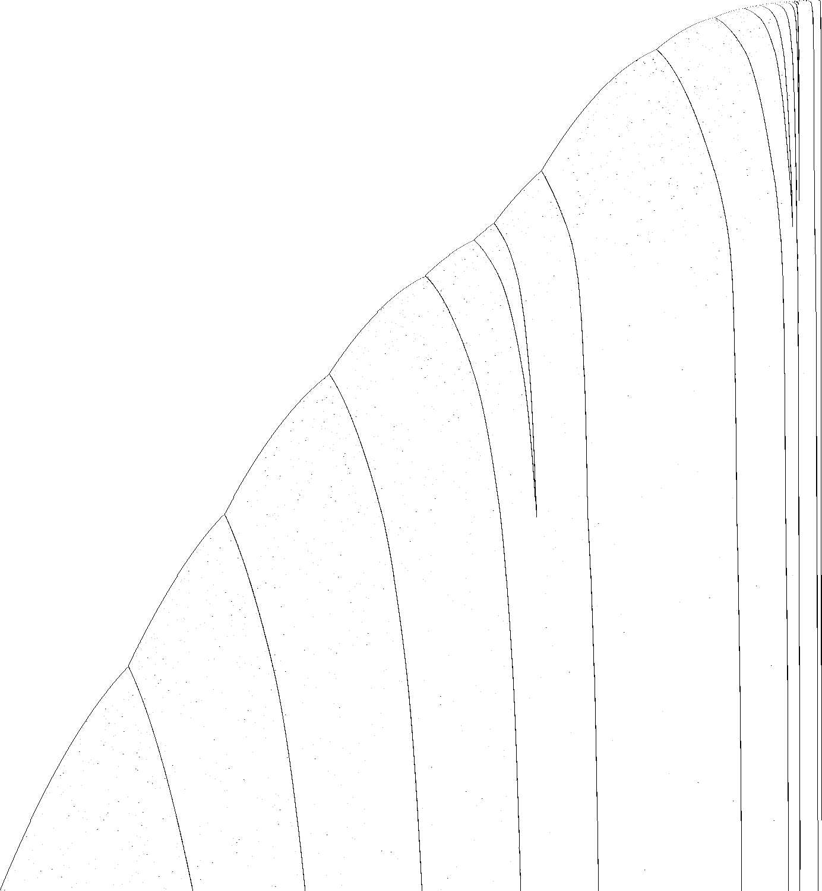

# 1RB0LC_1LC0RE_1LD1LB_1LA1LD_1RF0RA_---1RE

bbchallenge id 35069. One of the six-state holdouts whose halting from blank tape is open. Group G01.
**Family:** Complementing sweeper on a list of (010)^n blocks with a doubling front counter.

| state | read 0 | read 1 |
|---|---|---|
| A | 1RB | 0LC |
| B | 1LC | 0RE |
| C | 1LD | 1LB |
| D | 1LA | 1LD |
| E | 1RF | 0RA |
| F | --- | 1RE |

## What it does

**The question is open.** Each sweep of the head turns the period-3 background into its complement (`010` ↔ `101`, `100` ↔ `011`, `001` ↔ `110`; six shift rules proved in Lean). Read when the head is at the right end in state B, the tape is `(100)^x 1011 (010)^a1 11 (010)^a2 11 … (010)^n 01`: the last block *n* loses 2 copies per visit, the inner blocks lose 4, 4, 12, 20, … (one block stays at 100 or 120 for a long time), new blocks appear behind the front counter *x*, which often doubles or drops by 5 from one visit to the next like a binary counter. When the last block is used up, `120 1101` turns into a new last block of 119. No closed map yet.



Defect picture of the first 3·10^7 steps (time runs down, rows at equal step spacing; dark where the periodic background breaks); made with `c/st.c` and `py/img.py` of the shared folder, see Reproduce.

### Equivalence

Same transition graph with another start state: `1RB1RD_1RC1RB_1LD0RA_1RA0LE_1LF0LC_---1LE` (G07, other group's folder).

### The list

Read when the head is at the right end in state B (`./evw 1RB0LC_1LC0RE_1LD1LB_1LA1LD_1RF0RA_---1RE 3e7 B R 010,100,1`), with `F x` for the front
counter `(100)^x 10`, the numbers for blocks `(010)^a` separated by `11`, and the last block before `01 B>`:

| step | front x | blocks | last |
|---|---|---|---|
| 7,715,674 | 77 | 467 1077 352 113 120 | 42 |
| 8,075,963 | 202 | 447 1065 348 109 120 | 40 |
| 8,571,490 | 245 | 163 427 1053 344 105 120 | 38 |
| 9,278,929 | 490 | 123 407 1041 340 101 120 | 36 |
| 10,512,886 | 485 | 411 83 387 1029 336 97 120 | 34 |
| 12,580,355 | 970 | 331 43 367 1017 332 93 120 | 32 |

Each sweep complements the period-3 background (proved shift rules: `010` ↔ `101` and so on). The last block loses 2
copies per visit; the block 120 next to it waits; the blocks before it lose 4, 4, 12, 20 (counting from the right); the
front counter often doubles or drops by 5, and new blocks are born behind it. When the last block is used up
(5,753,047 → 7,715,674) the waiting block `120 1101` becomes the new last block of 119 copies (here 42 after a few
visits) and the list is rebuilt.

### Halting

The machine halts on reading 0 in state F; F is entered from E reading 0 (`1RF`). Not identified at the list level.

## What is established

| level | claim | where |
|---|---|---|
| kernel | **The halting configurations.** The machine stops exactly when it reads the symbol of a halting transition (F0); the generated statement covers every configuration. | `step_none_iff`, `lean/Blank.lean` |
| kernel | **No halt in the first 10,000 steps.** The list simulator of the shared library, proved to agree with the machine's semantics, runs 10,000 steps from blank tape without a halt, evaluated by Lean's kernel. | `blank_runs_kernel`, `lean/Blank.lean` |
| native | **No halt in the first 10^7 steps.** The same run, evaluated by compiled code. | `blank_runs_native`, `lean/Blank.lean` |
| trusted | **No halt in the first 10^9 steps.** The C simulator `tools/c/triage.c` runs 10^9 steps without a halt; at the end 83,871 cells have been visited and 30,719 of them hold a 1. | `holdouts/triage.json` |
| heuristic | **Growth shape: exp/sqrt.** Left of the start, the visited part of the tape grows like the square root of the step count, the signature of a head sweeping back and forth across the whole tape and adding a cell or a few at the end of each sweep (a *bouncer*-like shape) (fitted exponent 0.463). Right of the start it grows like the logarithm of the step count: each new cell costs a roughly constant factor more time, the signature of a *counter* or of a Collatz-like map whose values are written on the tape (fitted exponent 0.047). | `tools/py/bbtools/triage.py` |
| kernel | **Complementing shift rules.** C, A and D cross `(010)^n`, `(100)^n`, `(001)^n` to the left and B, E, A cross `(110)^n`, `(101)^n`, `(011)^n` to the right, 3n steps each, for every n. | `c_left` … `a_right`, `lean/Rules.lean` |
| trusted | **No halt in the first 3·10^10 steps.** A plain C simulator (`longrun.c`, on `tools/c/tm.h`) runs 3·10^10 steps from blank tape without a halt; at the end the head has visited cells -628,527 to 98 and 334,129 cells hold a 1. | `holdouts/1RB---_1RC0RA_1LD0RB_0LE0LC_1RE1LF_0RD0RB/c/longrun.c` |
| trusted | **The list at the right-end visits.** Read off the direct run to 3·10^7 steps: the last block goes 54, 52, 50, … (minus 2 per visit); a block of 100 (later 120) sits in front of it for many visits while the blocks before it shrink by 4, 4, 12, 20; the front counter runs 245, 490, 485, 970, 965 (doubling and subtracting 5 in turn) and moves differently when a new block is born | README.md |
| heuristic | **Deterministic counter, no sign of a halt.** The front counter behaves much like a binary counter (double, or subtract 5) and every other count moves by fixed amounts per visit; nothing points to the halting transition (F reading 0) being reached. | README.md |
| open | **Does it halt from blank tape?** Not known. The block list is understood one visit at a time; the front counter and the birth of new blocks have not been reduced to a map. | README.md, Further work |

Levels: kernel = checked by Lean's kernel; native = Lean with `native_decide`; trusted = a computation in this repository (C or Python) that is not formally verified; heuristic = an argument or an observation, not a proof.

## Further work

Pin down the front counter (it looks like a binary counter: double, or subtract 5) and how it feeds new blocks; derive the decrements of the inner blocks from the sweep structure; then simulate the list.

## Files

- `lean/Rules.lean`: the complementing shift rules, generated by `py/gen_rules.py` (`bbtools.symtm.prove` through `holdouts/1RB---_1RC0RA_1LD0RB_0LE0LC_1RE1LF_0RD0RB/py/rulegen.py`).
- Shared tools of this worker's six G01 machines, in `holdouts/1RB---_1RC0RA_1LD0RB_0LE0LC_1RE1LF_0RD0RB/`: `py/rulegen.py` (symbolic runs and Lean rule files on top of `bbtools.symtm`), `c/evw.c` (the tape at every visit of the head to one end, as runs of given words; `TAPE=...` starts from a constructed tape), `c/longrun.c` (plain direct simulation), `c/st.c` + `py/img.py` (the defect picture).

## Deep exact run

No halt in the first 7.58x10^18 steps: the macro simulator `holdouts/1RB0LB_1RC0LA_1LB0RD_1RE1RD_1RB1RF_1LA---/c/msim.c` with blocks of 6 cells ran
from blank tape to step 7,587,642,535,440,762,669. It is exact, and at this block size it agrees with the
direct simulator after 2,000,004,784 steps (`python3 holdouts/1RB0LB_1RC0LA_1LB0RD_1RE1RD_1RB1RF_1LA---/py/deep.py run 240`, then `verify`).

## Pages

- [`pages/holdouts/1RB0LC_1LC0RE_1LD1LB_1LA1LD_1RF0RA_---1RE/explainer.html`](../../pages/holdouts/1RB0LC_1LC0RE_1LD1LB_1LA1LD_1RF0RA_---1RE/explainer.html)
- [`pages/holdouts/1RB0LC_1LC0RE_1LD1LB_1LA1LD_1RF0RA_---1RE/proof-status.html`](../../pages/holdouts/1RB0LC_1LC0RE_1LD1LB_1LA1LD_1RF0RA_---1RE/proof-status.html)

## Reproduce

```sh
. /etc/profile.d/lean.sh      # after scripts/setup-lean.sh
holdouts/1RB0LC_1LC0RE_1LD1LB_1LA1LD_1RF0RA_---1RE/lean/check.sh
gcc -O2 -o triage tools/c/triage.c && ./triage 1RB0LC_1LC0RE_1LD1LB_1LA1LD_1RF0RA_---1RE 1000000000
python3 holdouts/1RB0LC_1LC0RE_1LD1LB_1LA1LD_1RF0RA_---1RE/py/gen_rules.py      # rewrites lean/Rules.lean
gcc -O2 -o evw holdouts/1RB---_1RC0RA_1LD0RB_0LE0LC_1RE1LF_0RD0RB/c/evw.c && ./evw 1RB0LC_1LC0RE_1LD1LB_1LA1LD_1RF0RA_---1RE 1000000000 B R 010,100,1 | less -S   # the tape at each visit
gcc -O2 -o longrun holdouts/1RB---_1RC0RA_1LD0RB_0LE0LC_1RE1LF_0RD0RB/c/longrun.c && ./longrun 1RB0LC_1LC0RE_1LD1LB_1LA1LD_1RF0RA_---1RE 30000000000   # 15-40 min
gcc -O2 -o st holdouts/1RB---_1RC0RA_1LD0RB_0LE0LC_1RE1LF_0RD0RB/c/st.c && ./st 1RB0LC_1LC0RE_1LD1LB_1LA1LD_1RF0RA_---1RE 30000000 1500 st.pgm && python3 holdouts/1RB---_1RC0RA_1LD0RB_0LE0LC_1RE1LF_0RD0RB/py/img.py st.pgm pages/holdouts/1RB0LC_1LC0RE_1LD1LB_1LA1LD_1RF0RA_---1RE/defects.png 1400 1500 3
```

<!-- related machines: written by holdouts/related.py -->

## Related machines

Other holdouts of the list of 608 that are tied to this one. The comparison of tables is exact; everything about runs was checked on the first 10^7 steps of each machine and is an observation, not a proof (`holdouts/related.py`, `holdouts/related.json`).

**Same table as the machine below, started in another state.** Renaming the states as shown turns this machine's table into the other one, the halting transition included. The other machine starts in its own state A, which is not this machine's A: its run from blank tape is the run of this table started in another state. These are different runs: in the first 10^7 steps of each, no configuration of this machine's run occurs in the other, even up to a shift of the tape. So each of these holdouts is its own halting question, and settling one does not settle another.

- [`1RB1RD_1RC1RB_1LD0RA_1RA0LE_1LF0LC_---1LE`](../1RB1RD_1RC1RB_1LD0RA_1RA0LE_1LF0LC_---1LE/README.md): rename A→C, B→D, C→A, D→B, E→E, F→F and exchange left and right; it is this table started in state C, in a mirror

<!-- end of related machines -->
