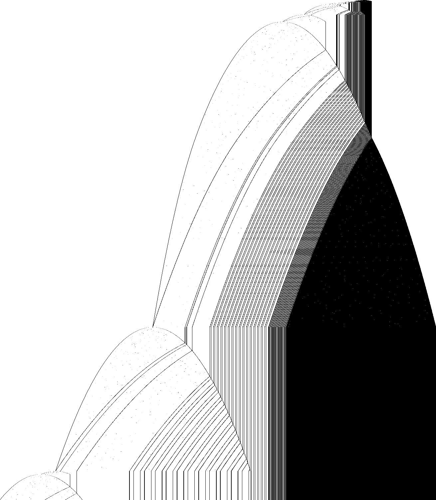

# 1RB0LC_1RC0RA_1LA0LD_1LE0RB_1LC1LF_0LA---

bbchallenge id 44840. One of the six-state holdouts whose halting from blank tape is open. Group G01.
**Family:** Two-phase list sweeper: a countdown block feeding a tail of (10)^3 blocks, then a left-growing bounce that rebuilds the list.

| state | read 0 | read 1 |
|---|---|---|
| A | 1RB | 0LC |
| B | 1RC | 0RA |
| C | 1LA | 0LD |
| D | 1LE | 0RB |
| E | 1LC | 1LF |
| F | 0LA | --- |

## What it does

**The question is open.** The tape is a list of blocks `(10)^n` separated by single 1s. In the **right phase** each sweep (head at the right end in state B) takes one `10` off the first block and appends a block `(10)^3 1` at the right end; this rule is proved in Lean for every length. When the first block is used up, the **left phase** starts: the head bounces between the left end and a marker, the first block grows by 4 copies per two bounces while the block after the marker shrinks by 2, the marker moves through the list and rebuilds it (the left phase rules are also proved). Then a new right phase starts with a much longer first block (3,728 copies at 6.8·10^8 steps, used up at 1.234·10^9). No closed map yet.



Defect picture of the first 3·10^7 steps (time runs down, rows at equal step spacing; dark where the periodic background breaks); made with `c/st.c` and `py/img.py` of the shared folder, see Reproduce.

### Equivalence

Same transition graph with other start states (other groups' folders): `1RB0LE_1RC1RF_1RD0RA_1LE0RC_1LC0LD_0RD---`
(G02), `1RB0RD_1LC0RA_1LA0LB_1RE0LC_1RA1RF_0RB---` (G10), `1RB0RC_1LC0LD_1RA0LB_1LE0RA_1LB1LF_0LC---` (G02).

### The two phases

Right phase, read at the visits of the head to the right end in state B (`./evw 1RB0LC_1RC0RA_1LA0LD_1LE0RB_1LC1LF_0LA--- 2e9 B R 10`):

| step | first block | rest of the list (blocks of (10)^n, separated by 1) |
|---|---|---|
| 8,470,124 | 626 | 485 24 83 264 [19,35]×15 19 37 [5,13]×13 5 10 3×427 2 |
| 679,059,433 | 3728 | 288 [541,917]×11 235 84 [323,163]×2 323 112 35 19 37 [5,13]×13 5 10 3×927 2 |
| 1,191,833,933 | 228 | the same, 3×4427 |

One sweep takes one `10` off the first block and appends a block of three (proved: `sweep_tail`, `sweep_mid`).

Left phase: when the first block is empty (1,233,737,369 steps) the head stops reaching the right end. It bounces
between the left end (state C) and a marker: `C>0 (01)^x 0 (01)^y 0011 0 ...` → three more copies in front and two
fewer behind the marker, then the marker `1` turns back into `0` with one more copy in front (proved: `left_a`,
`left_b`). When the block behind the marker is used up, the marker passes into the next block and the blocks around
it are rearranged (for instance `01^3070 0 01^91 00 11 0 01^99` → `01^3047 00 11 0 01^297 00 11 0 01^321 0 01^775`).
The first block thus collects a share of the whole list, and the next right phase starts with it.

Phase ends in the run: right phases end at 8.0·10^4, 1.96·10^7 and 1.234·10^9 steps; left phases end at 8.3·10^6
and 6.5·10^8 steps, and the third lasts past 3·10^9.

### Halting

The machine halts on reading 1 in state F, which is entered from E reading 1 (`1LF`); the halting condition at the
level of the list is not known.

## What is established

| level | claim | where |
|---|---|---|
| kernel | **The halting configurations.** The machine stops exactly when it reads the symbol of a halting transition (F1); the generated statement covers every configuration. | `step_none_iff`, `lean/Blank.lean` |
| kernel | **No halt in the first 10,000 steps.** The list simulator of the shared library, proved to agree with the machine's semantics, runs 10,000 steps from blank tape without a halt, evaluated by Lean's kernel. | `blank_runs_kernel`, `lean/Blank.lean` |
| native | **No halt in the first 10^7 steps.** The same run, evaluated by compiled code. | `blank_runs_native`, `lean/Blank.lean` |
| trusted | **No halt in the first 10^9 steps.** The C simulator `tools/c/triage.c` runs 10^9 steps without a halt; at the end 62,666 cells have been visited and 29,712 of them hold a 1. | `holdouts/triage.json` |
| heuristic | **Growth shape: exp/sqrt.** Left of the start, the visited part of the tape grows like the square root of the step count, the signature of a head sweeping back and forth across the whole tape and adding a cell or a few at the end of each sweep (a *bouncer*-like shape) (fitted exponent 0.553). Right of the start it grows like the logarithm of the step count: each new cell costs a roughly constant factor more time, the signature of a *counter* or of a Collatz-like map whose values are written on the tape (fitted exponent 0.04). | `tools/py/bbtools/triage.py` |
| kernel | **Right-phase sweep.** From the head at the right end in state B, one sweep turns `(10)^(a+2) 1 [(10)^(b+2) 1] ((10)^3 1)^(n+1)` into the same with one 10 less in the first block and one more block of three, in 4a+24n+53 steps (4a+4b+24n+73 with the middle block). | `sweep_tail`, `sweep_mid`, `lean/Rules.lean` |
| kernel | **Left-phase bounces.** From the head at the left end in state C: `(01)^(x+2) 0 (01)^(y+3) 00110` goes to the marker and back in 4x+22 steps, the first block three copies longer and the marker now a 1; the next bounce (4x+26 steps) adds one more copy and restores the marker 0. | `left_a`, `left_b`, `lean/Rules.lean` |
| trusted | **No halt in the first 10^11 steps.** A plain C simulator (`longrun.c`, on `tools/c/tm.h`) runs 10^11 steps from blank tape without a halt; at the end the head has visited cells -586,772 to 108,199 and 329,462 cells hold a 1. | `holdouts/1RB---_1RC0RA_1LD0RB_0LE0LC_1RE1LF_0RD0RB/c/longrun.c` |
| trusted | **The phases in the run.** In the direct run the right phases end (first block 0) at 8.0·10^4, 1.96·10^7 and 1.234·10^9 steps; the left phases between them last until 8.3·10^6 and 6.5·10^8 steps, and the third lasts past 3·10^9. From 1.234·10^9 to 2·10^9 steps the head reaches only the left end (47,163 times in state A, 23,587 in C), and the tail of 4655 blocks of three is left as it is. | README.md |
| heuristic | **Growing phases, no sign of a halt.** Each right phase is longer than the last (its first block is built from the whole list in the left phase), and the list behind it is periodic in large stretches (`[19,35]×15`, `[541,917]×11`, `[5,13]×13`), the signature of a deterministic hierarchical counter rather than a random walk. | README.md |
| open | **Does it halt from blank tape?** Not known. The two phases are understood one sweep at a time, but the rebuilding of the list in the left phase has not been reduced to a map. | README.md, Further work |

Levels: kernel = checked by Lean's kernel; native = Lean with `native_decide`; trusted = a computation in this repository (C or Python) that is not formally verified; heuristic = an argument or an observation, not a proof.

## Further work

Work out the marker passage of the left phase as a rule on the list (what a block of length y behind the marker becomes, and what is added to the first block), then the length of the next right phase as a function of the list. The periodic stretches of the list (`[19,35]`, `[541,917]`, `[5,13]`) suggest a hierarchical counter; a list-level simulator would then go far beyond direct simulation.

## Files

- `lean/Rules.lean`: the right-phase sweeps and left-phase bounces, generated by `py/gen_rules.py` (`bbtools.symtm.prove` through `holdouts/1RB---_1RC0RA_1LD0RB_0LE0LC_1RE1LF_0RD0RB/py/rulegen.py`).
- Shared tools of this worker's six G01 machines, in `holdouts/1RB---_1RC0RA_1LD0RB_0LE0LC_1RE1LF_0RD0RB/`: `py/rulegen.py` (symbolic runs and Lean rule files on top of `bbtools.symtm`), `c/evw.c` (the tape at every visit of the head to one end, as runs of given words; `TAPE=...` starts from a constructed tape), `c/longrun.c` (plain direct simulation), `c/st.c` + `py/img.py` (the defect picture).

## Pages

- [`pages/holdouts/1RB0LC_1RC0RA_1LA0LD_1LE0RB_1LC1LF_0LA---/explainer.html`](../../pages/holdouts/1RB0LC_1RC0RA_1LA0LD_1LE0RB_1LC1LF_0LA---/explainer.html)
- [`pages/holdouts/1RB0LC_1RC0RA_1LA0LD_1LE0RB_1LC1LF_0LA---/proof-status.html`](../../pages/holdouts/1RB0LC_1RC0RA_1LA0LD_1LE0RB_1LC1LF_0LA---/proof-status.html)

## Reproduce

```sh
. /etc/profile.d/lean.sh      # after scripts/setup-lean.sh
holdouts/1RB0LC_1RC0RA_1LA0LD_1LE0RB_1LC1LF_0LA---/lean/check.sh
gcc -O2 -o triage tools/c/triage.c && ./triage 1RB0LC_1RC0RA_1LA0LD_1LE0RB_1LC1LF_0LA--- 1000000000
python3 holdouts/1RB0LC_1RC0RA_1LA0LD_1LE0RB_1LC1LF_0LA---/py/gen_rules.py      # rewrites lean/Rules.lean
gcc -O2 -o evw holdouts/1RB---_1RC0RA_1LD0RB_0LE0LC_1RE1LF_0RD0RB/c/evw.c && ./evw 1RB0LC_1RC0RA_1LA0LD_1LE0RB_1LC1LF_0LA--- 1000000000 B R 10 | less -S   # the tape at each visit
gcc -O2 -o longrun holdouts/1RB---_1RC0RA_1LD0RB_0LE0LC_1RE1LF_0RD0RB/c/longrun.c && ./longrun 1RB0LC_1RC0RA_1LA0LD_1LE0RB_1LC1LF_0LA--- 100000000000   # 15-40 min
gcc -O2 -o st holdouts/1RB---_1RC0RA_1LD0RB_0LE0LC_1RE1LF_0RD0RB/c/st.c && ./st 1RB0LC_1RC0RA_1LA0LD_1LE0RB_1LC1LF_0LA--- 30000000 1500 st.pgm && python3 holdouts/1RB---_1RC0RA_1LD0RB_0LE0LC_1RE1LF_0RD0RB/py/img.py st.pgm pages/holdouts/1RB0LC_1RC0RA_1LA0LD_1LE0RB_1LC1LF_0LA---/defects.png 1400 1500 2
```
