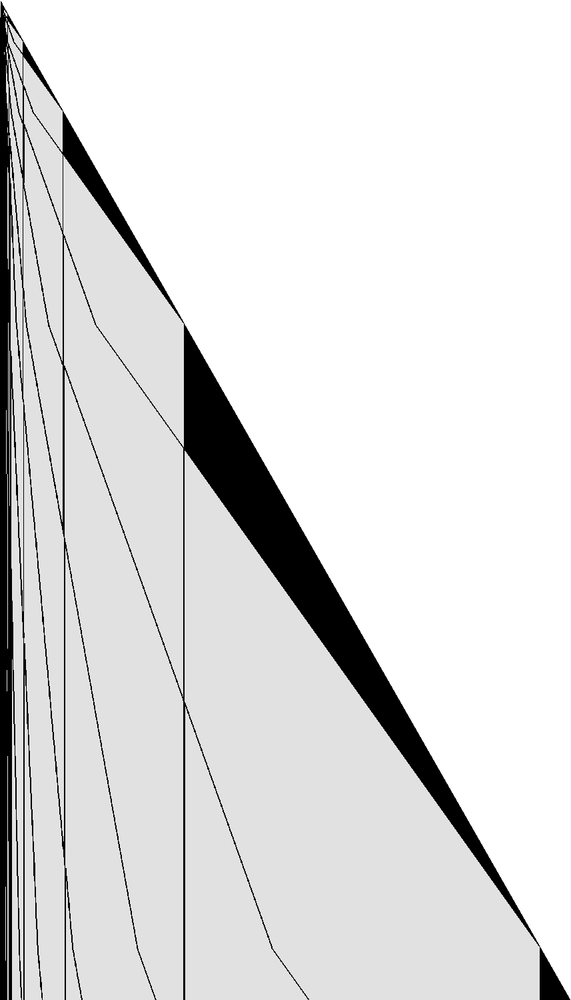

# 1RB0LC_1RC1RA_0RD1LE_1RE1RF_1LC0RB_---1RD

bbchallenge id 52486. One of the six-state holdouts whose halting from blank tape is open. Group G01.
**Family:** Glider collider with a unary counter (0111)^n at the slow end.

| state | read 0 | read 1 |
|---|---|---|
| A | 1RB | 0LC |
| B | 1RC | 1RA |
| C | 0RD | 1LE |
| D | 1RE | 1RF |
| E | 1LC | 0RB |
| F | --- | 1RD |

## What it does

The question is open. The head shuttles out from the right end over the background word `1110111110`, which it rewrites in a second phase and back (proved in Lean). It turns back at a defect or passes it depending on the defect's shape, and the excursions follow the ruler sequence of a binary counter whose bits are the defects. At the left end sits a unary counter `(0111)^n`: n grows by one at each of the rare events at that end (17 events between 3929 and 2.27·10^9 steps, n from 6 to 22). Between the ends, domains of another pattern grow at the right end and dissolve into gliders that travel left.

### A counter fed by gliders



One row every 2 visits of the head to the right end, in state B (time runs down), 3·10^7 steps; dark where the background of period 10 is broken. The left end of the tape is at the left.

Almost everywhere the tape repeats `0 1^3 0 1^5`. At the right end, now and then, a patch of a different pattern starts growing with the tape (the black wedges). When a wedge stops growing it is eroded from its left side, and the erosion sends gliders to the left (the thin lines). At the left end the tape reads `0111 01 (0111)^n`: a number n written in unary. It goes up by one at each event at that end:

| step | n |
|---|---|
| 3929 | 6 |
| 5610 | 7 |
| 11471 | 8 |
| … | … |
| 471362435 | 20 |
| 980924104 | 21 |
| 2265696633 | 22 |

A binary counter. The head does not cross the whole tape each time. Leaving the right end, around 2·10^8 steps, it turns back after about 900 cells on every other excursion, after about 15,600 on every fourth, 22,900 on every eighth, 26,600 to 29,500 on every sixteenth and beyond: the ruler sequence 1, 2, 1, 3, 1, 2, 1, 4, … of a binary counter whose bits are the defects, each letting the head through on every other visit. The left end, and with it the unary counter, is reached only when every bit lets the head through: an overflow.

A halt needs F reading 0, which the background never offers. Whether some glider can bring the right pattern to the head is open.

## What is established

| level | claim | where |
|---|---|---|
| kernel | **The halting configurations.** The machine stops exactly when it reads the symbol of a halting transition (F0); the generated statement covers every configuration. | `step_none_iff`, `lean/Blank.lean` |
| kernel | **No halt in the first 10,000 steps.** The list simulator of the shared library, proved to agree with the machine's semantics, runs 10,000 steps from blank tape without a halt, evaluated by Lean's kernel. | `blank_runs_kernel`, `lean/Blank.lean` |
| native | **No halt in the first 10^7 steps.** The same run, evaluated by compiled code. | `blank_runs_native`, `lean/Blank.lean` |
| trusted | **No halt in the first 10^9 steps.** The C simulator `tools/c/triage.c` runs 10^9 steps without a halt; at the end 64,251 cells have been visited and 50,921 of them hold a 1. | `holdouts/triage.json` |
| kernel | **The sweeps over the background.** Right: B crosses `(1110111110)^n` in 22n steps, leaving `(0111010111)^n`; left: C crosses the same word, leaving `(1101110101)^n`; and the two rules that restore the word from the other phase (18n steps each). | `b_sweep`, `c_sweep`, `a_sweep`, `c_sweep2`, `lean/Rules.lean` |
| trusted | **A unary counter at the left end.** Each time the left end grows (steps 3929, 5610, 11471, 15584, 50005, 101010, 405859, 851096, 2437041, 6477694, 16747343, 27831296, 79148713, 162337150, 471362435, 980924104, 2265696633) it grows by exactly one cell, and the tape there reads `0111 01 (0111)^n 0101…` with n one more than at the previous event (n = 6 at 3929, 22 at 2265696633). | `py/analyse.py records` |
| trusted | **Excursions follow a binary ruler sequence.** Between consecutive visits of the head to the right end in state B, near 2·10^8 steps, the head turns back after about 900, 15,600, 900, 22,900, 900, 15,600, 900, 28,500, … cells: the ruler sequence of a binary counter, each defect passing the head on every other visit. | `py/analyse.py excursions` |
| heuristic | **Domains and gliders.** In the defect picture, regions of a different pattern (black wedges) grow at the right end; when one stops growing, it is eaten from its left edge and sends gliders to the left; gliders slow down near the left end. The intervals between counter events grow irregularly (ratios 1.4 to 4). | the picture `pages/holdouts/1RB0LC_1RC1RA_0RD1LE_1RE1RF_1LC0RB_---1RD/defects.png` |
| heuristic | **Growth shape: exp/sqrt.** Left of the start, the visited part of the tape grows like the logarithm of the step count: each new cell costs a roughly constant factor more time, the signature of a counter or of a Collatz-like map whose values are written on the tape (fitted exponent 0.049). Right of the start it grows like the square root of the step count, the signature of a head sweeping back and forth across the whole tape and adding a cell or a few at the end of each sweep (a bouncer-like shape) (fitted exponent 0.495). | `tools/py/bbtools/triage.py` |
| open | **Does it halt from blank tape?.** Not known. Next step: Identify the domain types at the right end and their erosion, the gliders they release, and how a glider increments the counter; then accelerate the run event by event. | README.md, Further work |

Levels: kernel = checked by Lean's kernel; native = Lean with `native_decide`; trusted = a computation in this repository (C or Python) that is not formally verified; heuristic = an argument or an observation of pictures, not a proof.

## Further work

Identify the domain types at the right end and their erosion, the gliders they release, and how a glider increments the counter; then accelerate the run event by event.

## First look

Growth class **exp/sqrt** (left: exp, exponent 0.049; right: sqrt,
exponent 0.495). After 1,000,000,000 steps: 64,251 cells visited (24 left of the
start, 46,513 right), 50,921 ones.

- left, step 980,924,105: `C>0 1^4 0 1 0 1^3 0 1^3 0 1^3 0 1^3 0 1^3 0 1^3 0 1^3 0 1^3 0 1^3 0 1^3 0 1^3 0 1^3 0 1^3 0 1^3 0 1^3 0 1^3 0 1^3 0 1^3 0 1^3 0 1^3 0 1^3 0 1^3 0 1 0 1 0^2 1 0 1 0^2 1^3 0 1 0 1^3 0 1 0 1^3 0 1^3 0 1 0 1 0 1 0^2 1^3 0 1^3 0 1 0 1^3 0 1 0 1^3 0 1^3 0 1^3 0 1^3 0 1 0 1 0 1^3 0 1^3 0 1^3 0 1^3 0 1^3 0 `
- right, step 970,522,828: `0 1^5 0 1^3 0 1^3 0 1^3 0 1^3 0 1^3 0 1^3 0 1^3 0 1^3 0 1^3 0 1^3 0 1^3 0 1^3 0 1^3 0 1^3 0 1^3 0 1^3 0 1^3 0 1^3 0 1^3 0 1^3 0 1^3 0^2 1^3 0^2 1^3 0 1^3 0 1^5 0 1^5 0 1^3 0^2 1 0 1^3 0 1^3 0 1^3 0 1^5 0 1^5 0 1^3 0 1^3 0 1^3 0 1^7 0 1^3 0 1^3 0 1^3 0 1^3 0 1^3 0 1^5 0 1^3 0 1^5 0^2 1 0 1^3 0 1^5 0 `
- right, step 986,319,424: `0 1^5 0 1^3 0 1^3 0 1^3 0 1^3 0 1^3 0 1^3 0 1^3 0 1^3 0 1^3 0 1^3 0 1^3 0 1^3 0 1^3 0 1^3 0 1^3 0 1^3 0 1^3 0 1^3 0 1^3 0 1^3 0 1^3 0 1^3 0^2 1^4 0 1^3 0^2 1^5 0 1^5 0 1^3 0 1^3 0^2 1^9 0 1^5 0 1^5 0 1^3 0 1^3 0 1^3 0 1^7 0 1^3 0 1^3 0 1^3 0 1^3 0 1^3 0 1^5 0 1^3 0 1^5 0 1^10 0 1 0 1^3 0 1^7 0 1^3 0`

## Files

- `lean/Rules.lean`: the shift rules, generated by `py/rules.py` with `bbtools.symtm.prove` (shared helper: `holdouts/1RB0LB_1RC0LA_1RD---_0RE1LD_1LF0RF_1LA1RB/py/sweeps.py`).
- `py/analyse.py image`: the defect picture `pages/holdouts/1RB0LC_1RC1RA_0RD1LE_1RE1RF_1LC0RB_---1RD/defects.png`; `py/analyse.py records`: the bursts of growth at the slow end (up to 3·10^9 steps, several minutes).

## Files

- `lean/Rules.lean`: the shift rules, generated by `py/rules.py` with `bbtools.symtm.prove` (shared helper: `holdouts/1RB0LB_1RC0LA_1RD---_0RE1LD_1LF0RF_1LA1RB/py/sweeps.py`).
- `py/analyse.py image`: the defect picture `pages/holdouts/1RB0LC_1RC1RA_0RD1LE_1RE1RF_1LC0RB_---1RD/defects.png`; `py/analyse.py records`: the bursts of growth at the slow end (up to 3·10^9 steps, several minutes).

## Deciders tried (F11, 13 November 2026)

None closes. Each reaches a halting configuration in its abstraction, which says nothing about halting.

- n-gram CPS (`tools/c/ngramcps.c`), equal widths on both sides: a halting local configuration is reached with plain up to width 24, history 1 up to width 24, history 2 up to width 22, history 3 up to width 24, LRU history up to width 7 (larger widths ran out of the 150 s or 60 million configuration budget).
- n-gram CPS with every cell tagged by its position mod p: fails for p = 2 up to width 20, p = 3 up to width 16, p = 4 up to width 20, p = 6 up to width 16.
- n-gram CPS where each side also carries the state of a small automaton that has read that side from the far end (every automaton with up to 3 states on both sides, or 4 states on one side), with position mod 1..4 and widths 4, 6, 8: no closed set without a halt in all 120 parameter sets.
- Run-length windows (the K nearest runs of equal macro cells on each side, run lengths kept exactly below T and mod M above): fails for all 72 parameter sets (cells of 1 to 4 bits, K = 2, 4, 6, T = 2, 4, M = 1, 2, 4).
- Two-automaton closed tape language by SAT (a deterministic automaton reading each side inward, n states each, CaDiCaL): no solution for n = 2..9; n = 10 not finished in 150 s.

## Where a halt can come from

`lean/Route.lean` (kernel, written by `py/route.py`): `halt_route`, two steps before any halt the machine is in one
of: C with 0 under the head, 1 right, 0 two right; F with 1 under the head, 1 right, 0 two right.

## Pages

- [`pages/holdouts/1RB0LC_1RC1RA_0RD1LE_1RE1RF_1LC0RB_---1RD/explainer.html`](../../pages/holdouts/1RB0LC_1RC1RA_0RD1LE_1RE1RF_1LC0RB_---1RD/explainer.html)
- [`pages/holdouts/1RB0LC_1RC1RA_0RD1LE_1RE1RF_1LC0RB_---1RD/proof-status.html`](../../pages/holdouts/1RB0LC_1RC1RA_0RD1LE_1RE1RF_1LC0RB_---1RD/proof-status.html)

## Check

```sh
. /etc/profile.d/lean.sh && holdouts/1RB0LC_1RC1RA_0RD1LE_1RE1RF_1LC0RB_---1RD/lean/check.sh
python3 holdouts/1RB0LC_1RC1RA_0RD1LE_1RE1RF_1LC0RB_---1RD/py/rules.py && git diff --exit-code holdouts/1RB0LC_1RC1RA_0RD1LE_1RE1RF_1LC0RB_---1RD/lean/Rules.lean
```
