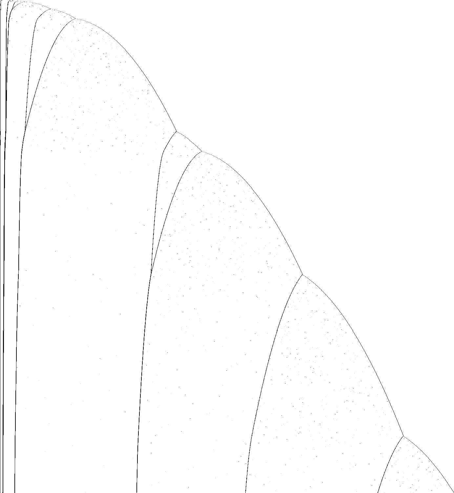

# 1RB0LD_1RC0RF_0LD0LE_1RF1LC_0LB1LE_0RA---

bbchallenge id 18251. One of the six-state holdouts whose halting from blank tape is open. Group G01.
**Family:** Base-4 drifting counter: blocks of (010)^n eaten at rates 4, 12, 48, 192, ... with a wall phase that reloads the first block.

| state | read 0 | read 1 |
|---|---|---|
| A | 1RB | 0LD |
| B | 1RC | 0RF |
| C | 0LD | 0LE |
| D | 1RF | 1LC |
| E | 0LB | 1LE |
| F | 0RA | --- |

## What it does

**The question is open.** The tape is a list of blocks `(010)^n` separated by short walls `(10)^s` (s = 4, 5, 6 or 8) and, near the right end, by single 1s. Each time the head comes back to the left end in state C, the first block has lost 4 copies and the *i*-th block 3·4^*i*−1 copies: a counter in base 4 whose digits are whole blocks. When the first block is down to 5 copies, a wall phase of *s*−1 visits eats 3 copies per visit from the second block, which then becomes the new first block (seen: 48 → 17; predicted next: 792 → 773). The tail at the right end runs a cycle of four visits that adds one block of 4^k-sized length. Shift rules are proved in Lean; the list rule is checked against the run. The halting condition at the level of the list is not identified yet.



Defect picture of the first 3·10^7 steps (time runs down, rows at equal step spacing; dark where the periodic background breaks); made with `c/st.c` and `py/img.py` of the shared folder, see Reproduce.

### Equivalence

Same transition graph with other start states (other groups' folders): `1RB1LE_0RC---_1RD0LA_1RE0RB_0LA0LF_0LD1LF`
(G03), `1RB0RD_0LC0LF_1RD1LB_0RE---_1RA0LC_0LA1LF` (G02). The picture and the drifting walls look like those of
`1RB---_1RC0RA_1LD0RB_0LE0LC_1RE1LF_0RD0RB` (G01), but the rule tables are different.

### The counter

At each visit of the head to the left end in state C (`./evw 1RB0LD_1RC0RF_0LD0LE_1RF1LC_0LB1LE_0RA--- 2e10 C L 010,10,1`; 51 visits up to 1.54·10^10
steps) the tape is `(010)^a1 (10)^s1 (010)^a2 (10)^s2 ... (010)^an 1 (010)^t1 1 ...`: blocks of `010` separated
by walls `(10)^s` (s = 4, 5, 6 or 8), and a short tail separated by single 1s.

- **Main phase.** From one visit to the next a1 loses 4 and block i ≥ 2 loses 3·4^(i−1) (12, 48, 192, 768, ...).
  Every block is a multiple of its rate, so it reaches 0 exactly; it then disappears and its two walls merge
  (`(10)^4` + `(10)^4` → `(10)^8`), and the blocks behind it move up one place and slow down by a factor 4.
- **Tail.** The last block v (rate r) runs a cycle of four visits: `v |4|` → `v−r |1| 4r` → `v−2r |1| 8r+1` →
  `v−3r |1| 4r+1 |1| 16r` → `v−4r |4| 32r`, so a new block of 32r joins the list every four visits.
- **Wall phase.** When a1 = 5, the next s1−1 visits take 3 copies per visit from a2 (the other blocks keep their
  rates, shifted one place), while the wall in front of it wears down; then a2 − 3·s1 − 7 becomes the new a1.
  Seen: 48 with s1 = 8 → 17 at 5.29·10^9 steps; predicted next: 792 with s1 = 4 → 773.

| step | a1 | a2 a3 a4 a5 | tail |
|---|---|---|---|
| 5,288,115,385 | 17 | 828 2544 22464 20736 | 15361 |
| 6,024,967,865 | 13 | 816 2496 22272 19968 | 12289 · 12288 |
| 7,513,595,257 | 9 | 804 2448 22080 19200 | 9217 · 24577 |
| 15,391,174,905 | 5 | 792 2400 21888 18432 | 6145 · 12289 · 49152 |

The main-phase decrements agree with every pair of consecutive visits in the run (`c_right`, `c_bounce` and the
other shift rules of `lean/Rules.lean` are the sweeps they are made of).

### Halting

The machine halts on reading 1 in state F. The main phase needs a1 = 1 mod 4 to come down to exactly 5; the reload
a2 − 3·s1 − 7 is 1 mod 4 when s1 is a multiple of 4 (a2 is a multiple of 12), not for walls of 5 or 6 (a `(10)^6`
appears near the tail at 4.95·10^9 steps). That is not a halting condition, though: started by hand from
`C> (010)^5 (10)^s (010)^48 (10)^4 (010)^96` with s = 6 the machine ran 1.5·10^10 steps without a halt (s = 4: 1.1·10^8 steps checked),
switching between the `(010)` form above and a second form with blocks `(001)^n` and walls `(01)^s`, in which the
same counter runs. Small hand-made tapes with a1 ≤ 9 and walls of 4, 5, 6, 8 ran 3000 visits without a halt. The
halting condition at the level of the list is not identified.

## What is established

| level | claim | where |
|---|---|---|
| kernel | **The halting configurations.** The machine stops exactly when it reads the symbol of a halting transition (F1); the generated statement covers every configuration. | `step_none_iff`, `lean/Blank.lean` |
| kernel | **No halt in the first 10,000 steps.** The list simulator of the shared library, proved to agree with the machine's semantics, runs 10,000 steps from blank tape without a halt, evaluated by Lean's kernel. | `blank_runs_kernel`, `lean/Blank.lean` |
| native | **No halt in the first 10^7 steps.** The same run, evaluated by compiled code. | `blank_runs_native`, `lean/Blank.lean` |
| trusted | **No halt in the first 10^9 steps.** The C simulator `tools/c/triage.c` runs 10^9 steps without a halt; at the end 67,112 cells have been visited and 22,378 of them hold a 1. | `holdouts/triage.json` |
| heuristic | **Growth shape: exp/sqrt.** Left of the start, the visited part of the tape grows like the logarithm of the step count: each new cell costs a roughly constant factor more time, the signature of a *counter* or of a Collatz-like map whose values are written on the tape (fitted exponent 0.051). Right of the start it grows like the square root of the step count, the signature of a head sweeping back and forth across the whole tape and adding a cell or a few at the end of each sweep (a *bouncer*-like shape) (fitted exponent 0.483). | `tools/py/bbtools/triage.py` |
| kernel | **Shift rules over the (010) background.** Eight shift rules for every length n, among them the wall `1011` crossing `(010)^2n` to the right in 28n steps, the turn at the right end (38n+20 steps), and the left-going crossings of `(010)`, `(001)`, `(100)` in 5n steps. | `c_right`, `c_bounce`, `e_left` …, `lean/Rules.lean` |
| trusted | **No halt in the first 10^11 steps.** A plain C simulator (`longrun.c`, on `tools/c/tm.h`) runs 10^11 steps from blank tape without a halt; at the end the head has visited cells -122 to 896,652 and 298,934 cells hold a 1. | `holdouts/1RB---_1RC0RA_1LD0RB_0LE0LC_1RE1LF_0RD0RB/c/longrun.c` |
| trusted | **The list at the left-end visits.** All 51 visits of the head to the left end in state C up to 1.54·10^10 steps were read off the direct run. Between consecutive visits of the main phase the first block loses 4 copies and block *i* loses 3·4^*i*−1 (every comparison agrees); a wall phase (96, 93, 90) reloads the first block with 89, which runs 89, 85, …, 5; a second wall phase (36, 33, …, 18) reloads it with 17, which runs 17, 13, 9, 5. | README.md, the map |
| heuristic | **A deterministic counter, no sign of a halt.** The run is a nested counter whose digits are block lengths of the form 3·4^km (plus 1 at the tail); nothing random is involved, so the probviously argument does not apply. Halting needs F to read 1; hand-made tapes with other walls in front of the second block (s = 6 instead of 4 or 8) also ran 1.5·10^10 steps without a halt. | README.md |
| open | **Does it halt from blank tape?** Not known. The list rule is deterministic but has more cases than are written down here (a second form with (001)^n blocks, the walls of 5 and 6 near the tail); the halting condition at the level of the list is not identified. | README.md, Further work |

Levels: kernel = checked by Lean's kernel; native = Lean with `native_decide`; trusted = a computation in this repository (C or Python) that is not formally verified; heuristic = an argument or an observation, not a proof.

## Further work

Write the list-level simulator (main phase, merges, tail cycle, wall phase with the reload a2 − 3·s1 − 7) including the second form with `(001)^n` blocks, and check it against all 51 visits and against runs from constructed tapes; then run it far and look for a configuration that reaches F on a 1. The rates 4^i suggest the blocks are digits of a base-4 counter, which would give step counts in closed form.

## Files

- `lean/Rules.lean`: shift rules over the (010) background, generated by `py/gen_rules.py` (`bbtools.symtm.prove` through `holdouts/1RB---_1RC0RA_1LD0RB_0LE0LC_1RE1LF_0RD0RB/py/rulegen.py`).
- Shared tools of this worker's six G01 machines, in `holdouts/1RB---_1RC0RA_1LD0RB_0LE0LC_1RE1LF_0RD0RB/`: `py/rulegen.py` (symbolic runs and Lean rule files on top of `bbtools.symtm`), `c/evw.c` (the tape at every visit of the head to one end, as runs of given words; `TAPE=...` starts from a constructed tape), `c/longrun.c` (plain direct simulation), `c/st.c` + `py/img.py` (the defect picture).

## Pages

- [`pages/holdouts/1RB0LD_1RC0RF_0LD0LE_1RF1LC_0LB1LE_0RA---/explainer.html`](../../pages/holdouts/1RB0LD_1RC0RF_0LD0LE_1RF1LC_0LB1LE_0RA---/explainer.html)
- [`pages/holdouts/1RB0LD_1RC0RF_0LD0LE_1RF1LC_0LB1LE_0RA---/proof-status.html`](../../pages/holdouts/1RB0LD_1RC0RF_0LD0LE_1RF1LC_0LB1LE_0RA---/proof-status.html)

## Reproduce

```sh
. /etc/profile.d/lean.sh      # after scripts/setup-lean.sh
holdouts/1RB0LD_1RC0RF_0LD0LE_1RF1LC_0LB1LE_0RA---/lean/check.sh
gcc -O2 -o triage tools/c/triage.c && ./triage 1RB0LD_1RC0RF_0LD0LE_1RF1LC_0LB1LE_0RA--- 1000000000
python3 holdouts/1RB0LD_1RC0RF_0LD0LE_1RF1LC_0LB1LE_0RA---/py/gen_rules.py      # rewrites lean/Rules.lean
gcc -O2 -o evw holdouts/1RB---_1RC0RA_1LD0RB_0LE0LC_1RE1LF_0RD0RB/c/evw.c && ./evw 1RB0LD_1RC0RF_0LD0LE_1RF1LC_0LB1LE_0RA--- 1000000000 C L 010,10,1 | less -S   # the tape at each visit
gcc -O2 -o longrun holdouts/1RB---_1RC0RA_1LD0RB_0LE0LC_1RE1LF_0RD0RB/c/longrun.c && ./longrun 1RB0LD_1RC0RF_0LD0LE_1RF1LC_0LB1LE_0RA--- 100000000000   # 15-40 min
gcc -O2 -o st holdouts/1RB---_1RC0RA_1LD0RB_0LE0LC_1RE1LF_0RD0RB/c/st.c && ./st 1RB0LD_1RC0RF_0LD0LE_1RF1LC_0LB1LE_0RA--- 30000000 1500 st.pgm && python3 holdouts/1RB---_1RC0RA_1LD0RB_0LE0LC_1RE1LF_0RD0RB/py/img.py st.pgm pages/holdouts/1RB0LD_1RC0RF_0LD0LE_1RF1LC_0LB1LE_0RA---/defects.png 1400 1500 3
```
