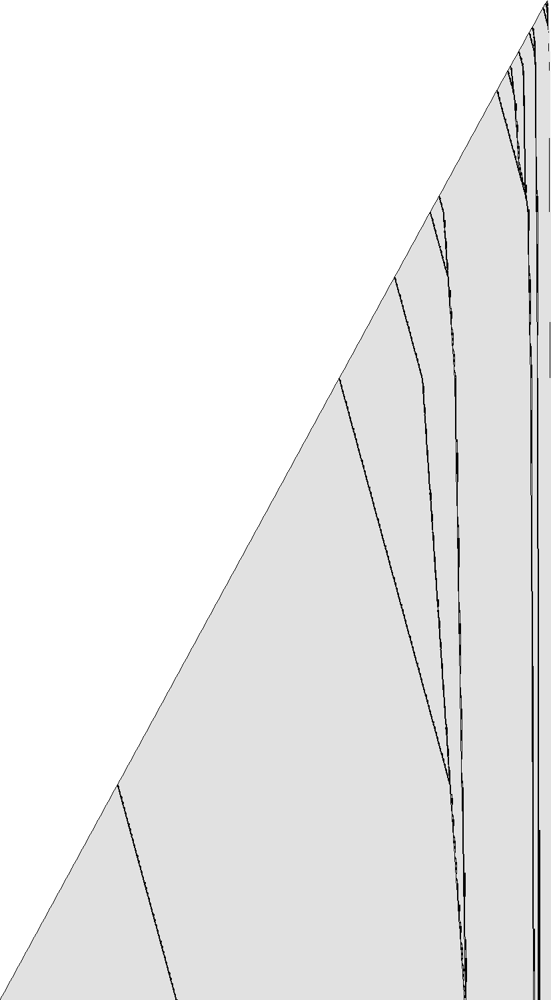

# 1RB0LE_0RC---_1RD0LA_1RE0RA_0LF1LD_1LC1RF

bbchallenge id 35160. One of the six-state holdouts whose halting from blank tape is open. Group G01.
**Family:** Glider collider: a bouncer over a period-12 background, gun at the left end, counter at the right.

| state | read 0 | read 1 |
|---|---|---|
| A | 1RB | 0LE |
| B | 0RC | --- |
| C | 1RD | 0LA |
| D | 1RE | 0RA |
| E | 0LF | 1LD |
| F | 1LC | 1RF |

## What it does

The question is open. The head shuttles out from the left end over the background word `100110001001`, turning back or passing at each defect depending on its shape (so the defects act as the digits of a counter), and rewriting the background as `(01)^4 1^4` going right and back going left (proved in Lean). Defects of the background move as gliders from a gun at the left end to a few nearly stationary defects near the right end, which grows in rare bursts. No macro map is known.

### A 12-cell word in two phases

When the head is back at the left end the tape reads `100110001001` over and over; the sweep to the right turns each copy into `(01)^4 1^4` (28 steps a word), the sweep to the left turns it back (60 steps a word). Each return of the head to the left end (in state E) adds four cells there, a word every three returns.

### Gliders and a pile



One row every 3 visits of the head to the left end in state A (time runs down), 3.4·10^7 steps; dark where the background of period 12 is broken.

The dark lines are defects that every sweep reshapes and moves. They are born at the left end, shortly after a burst of growth at the right end, travel right, slow down and merge, and end in a few almost stationary defects near the right end. Bursts get rarer as the tape grows (23 in 3·10^9 steps), so the right side grows like a logarithm.

A halt needs B reading 1. Nothing in the run so far comes close, and the collision rules are not known, so there is no estimate either way.

## What is established

| level | claim | where |
|---|---|---|
| kernel | **The halting configurations.** The machine stops exactly when it reads the symbol of a halting transition (B1); the generated statement covers every configuration. | `step_none_iff`, `lean/Blank.lean` |
| kernel | **No halt in the first 10,000 steps.** The list simulator of the shared library, proved to agree with the machine's semantics, runs 10,000 steps from blank tape without a halt, evaluated by Lean's kernel. | `blank_runs_kernel`, `lean/Blank.lean` |
| native | **No halt in the first 10^7 steps.** The same run, evaluated by compiled code. | `blank_runs_native`, `lean/Blank.lean` |
| trusted | **No halt in the first 10^9 steps.** The C simulator `tools/c/triage.c` runs 10^9 steps without a halt; at the end 53,101 cells have been visited and 25,038 of them hold a 1. | `holdouts/triage.json` |
| kernel | **The two sweeps over the background.** Going right, A crosses `(000100110011)^n` in 28n steps and leaves `(101011111010)^n`, a rotation of `(01)^4 1^4`; going left, D crosses `((01)^4 1^4)^n` in 60n steps and leaves a rotation of the background. | `a_sweep`, `d_sweep`, `lean/Rules.lean` |
| trusted | **The right end grows in rare events.** Up to 3·10^9 steps the right end grows in 23 bursts (at 4452, 34862, …, 349120206, 601597011, 1209167380, 2298066779, 2605468340); they alternate between two shapes, ending `…1100` and `…0101100`. | `py/analyse.py records` |
| trusted | **Bursts and glider births.** A new glider appears at the left end within one sweep after most bursts of the second shape (e.g. bursts at 62687, 111515, 1680471, 3889033, 44193243, 140427539, 601597011; births at 64571, 114290, 1690591, 3906687, 44244711, 140517476, 601771479), up to 1.3·10^9 steps. | the defect view (`py/sweeps.py`) |
| heuristic | **Gliders, merges and a pile.** Gliders move right, then slow down and merge; three or four nearly stationary defects sit within about 300 words of the right end. Around 2·10^8 steps the head, leaving the left end, turns at the first defect on most excursions and passes it on 3 of every 12 (pattern `000010001010`, 1 = passes). | the picture `pages/holdouts/1RB0LE_0RC---_1RD0LA_1RE0RA_0LF1LD_1LC1RF/defects.png`, `py/analyse.py excursions` |
| heuristic | **Growth shape: exp/sqrt.** Left of the start, the visited part of the tape grows like the square root of the step count, the signature of a head sweeping back and forth across the whole tape and adding a cell or a few at the end of each sweep (a bouncer-like shape) (fitted exponent 0.484). Right of the start it grows like the logarithm of the step count: each new cell costs a roughly constant factor more time, the signature of a counter or of a Collatz-like map whose values are written on the tape (fitted exponent 0.071). | `tools/py/bbtools/triage.py` |
| open | **Does it halt from blank tape?.** Not known. Next step: Catalogue the glider shapes, speeds and merge rules and the two right-end reactions, then accelerate the run as a particle system. | README.md, Further work |

Levels: kernel = checked by Lean's kernel; native = Lean with `native_decide`; trusted = a computation in this repository (C or Python) that is not formally verified; heuristic = an argument or an observation of pictures, not a proof.

## Further work

Catalogue the glider shapes, speeds and merge rules and the two right-end reactions, then accelerate the run as a particle system.

## First look

Growth class **exp/sqrt** (left: sqrt, exponent 0.484; right: exp,
exponent 0.071). After 1,000,000,000 steps: 53,101 cells visited (33,407 left of the
start, 72 right), 25,038 ones.

- left, step 971,130,252: `A>0 0 1 0^3 1 0^2 1^2 0^3 1 0^2 1^2 0^2 1^2 0^3 1 0^2 1^2 0^2 1^2 0^3 1 0^2 1^2 0^2 1^2 0^3 1 0^2 1^2 0^2 1^2 0^3 1 0^2 1^2 0^2 1^2 0^3 1 0^2 1^2 0^2 1^2 0^3 1 0^2 1^2 0^2 1^2 0^3 1 0^2 1^2 0^2 1^2 0^3 1 0^2 1^2 0^2 1^2 0^3 1 0^2 1^2 0^2 1^2 0^3 1 0^2 1^2 0^2 1^2 0^3 1 0^2 1^2 0^2 1^2 0^3 1 0^2 1^2 `
- left, step 986,903,518: `A>0 0 1 0^3 1 0^2 1^2 0^3 1 0^2 1^2 0^2 1^2 0^3 1 0^2 1^2 0^2 1^2 0^3 1 0^2 1^2 0^2 1^2 0^3 1 0^2 1^2 0^2 1^2 0^3 1 0^2 1^2 0^2 1^2 0^3 1 0^2 1^2 0^2 1^2 0^3 1 0^2 1^2 0^2 1^2 0^3 1 0^2 1^2 0^2 1^2 0^3 1 0^2 1^2 0^2 1^2 0^3 1 0^2 1^2 0^2 1^2 0^3 1 0^2 1^2 0^2 1^2 0^3 1 0^2 1^2 0^2 1^2 0^3 1 0^2 1^2 `
- right, step 601,597,011: `1 0 1 0 1 0 1^5 0 1 0 1 0 1 0 1^5 0 1 0 1 0 1 0 1^5 0 1 0 1 0 1 0 1^5 0 1 0 1 0 1 0 1^5 0 1 0 1 0 1 0 1^5 0 1 0 1 0 1 0 1^5 0 1 0 1 0 1 0 1^5 0 1 0 1 0 1 0 1^5 0 1 0 1 0 1 0 1^5 0 1 0 1 0 1 0 1^5 0 1 0 1 0 1 0 1^5 0 1 0 1 0 1 0 1^5 0 1 0 1 0 1 0 1^5 0 1 0 1 0 1 0 1^5 0 1 0 1 0 1 0 1^5 0 1 0 1 0 1 0 `

## Files

- `lean/Rules.lean`: the shift rules, generated by `py/rules.py` with `bbtools.symtm.prove` (shared helper: `holdouts/1RB0LB_1RC0LA_1RD---_0RE1LD_1LF0RF_1LA1RB/py/sweeps.py`).
- `py/analyse.py image`: the defect picture `pages/holdouts/1RB0LE_0RC---_1RD0LA_1RE0RA_0LF1LD_1LC1RF/defects.png`; `py/analyse.py records`: the bursts of growth at the slow end (up to 3·10^9 steps, several minutes).

## Files

- `lean/Rules.lean`: the shift rules, generated by `py/rules.py` with `bbtools.symtm.prove` (shared helper: `holdouts/1RB0LB_1RC0LA_1RD---_0RE1LD_1LF0RF_1LA1RB/py/sweeps.py`).
- `py/analyse.py image`: the defect picture `pages/holdouts/1RB0LE_0RC---_1RD0LA_1RE0RA_0LF1LD_1LC1RF/defects.png`; `py/analyse.py records`: the bursts of growth at the slow end (up to 3·10^9 steps, several minutes).

## Pages

- [`pages/holdouts/1RB0LE_0RC---_1RD0LA_1RE0RA_0LF1LD_1LC1RF/explainer.html`](../../pages/holdouts/1RB0LE_0RC---_1RD0LA_1RE0RA_0LF1LD_1LC1RF/explainer.html)
- [`pages/holdouts/1RB0LE_0RC---_1RD0LA_1RE0RA_0LF1LD_1LC1RF/proof-status.html`](../../pages/holdouts/1RB0LE_0RC---_1RD0LA_1RE0RA_0LF1LD_1LC1RF/proof-status.html)

## Check

```sh
. /etc/profile.d/lean.sh && holdouts/1RB0LE_0RC---_1RD0LA_1RE0RA_0LF1LD_1LC1RF/lean/check.sh
python3 holdouts/1RB0LE_0RC---_1RD0LA_1RE0RA_0LF1LD_1LC1RF/py/rules.py && git diff --exit-code holdouts/1RB0LE_0RC---_1RD0LA_1RE0RA_0LF1LD_1LC1RF/lean/Rules.lean
```
