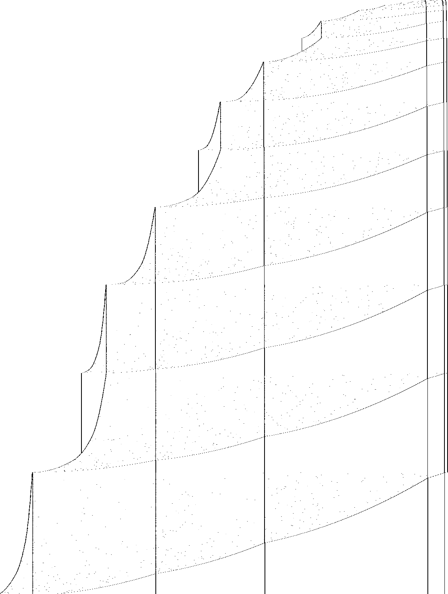

# 1RB0LE_1RC0LB_1RD0RC_1LA1RC_---1LF_1LB1LD

bbchallenge id 173433. One of the six-state holdouts whose halting from blank tape is open. Group G01.
**Family:** Antihydra-like: A → (3A+g)/2 or a push A → (A+g)/4 on a growing list of (1101)^n blocks, g = 6 + sum b_k/2^k.

| state | read 0 | read 1 |
|---|---|---|
| A | 1RB | 0LE |
| B | 1RC | 0LB |
| C | 1RD | 0RC |
| D | 1LA | 1RC |
| E | --- | 1LF |
| F | 1LB | 1LD |

## What it does

**The question is open, and halting looks very unlikely.** The tape is a list of blocks `(1101)^n` separated by single 0s. At each *rest* (head at the left end in state B) the tape is `B>1 P (1101)^A 0 (1101)^b1 0 …` with `P` = `0` or `000`, and the list enters only through *g* = 6 + *b*_1/2 + *b*_2/4 + …. The next rest is *A* → (3*A*+*g*)/2 (with −3 or −6 for type 0), or, when the parity is wrong, a **push**: *A*+1 joins the list and *A* restarts at about (*A*+*g*)/4. This map reproduces all 36 rests of the direct run up to 10^10 steps and 350 rests started from random configurations; it is built from sweep rules proved in Lean, but the map itself is not proved. Iterated 2·10^5 times from blank tape, *A* never comes near the tiny values from which the machine halts.



Defect picture of the first 3·10^7 steps (time runs down, rows at equal step spacing; dark where the periodic background breaks); made with `c/st.c` and `py/img.py` of the shared folder, see Reproduce.

No other machine of the same transition graph is among the holdouts.

### Rests

A *rest* is a moment the head is at the left end in state B reading 1 with the tape

    B>1 P (1101)^A 0 (1101)^b1 0 (1101)^b2 0 ... 0 (1101)^bk        P = 0 (type 0) or 000 (type 000)

(blocks separated by single 0s, no marker). Between rests a marker `00` is put into the last block and moves to
the front while a counter grows at the left end (6·2^k copies cross the marker per unit at depth k; proved
for k = 0 as `u0_*`); the counter is then multiplied by four and paid out at three copies for two in the transfer phase (`t_one`,
`t_two`). The upshot is an exact map in which the list enters only through

    g = 6 + b1/2 + b2/4 + ... + bk/2^k,        g([]) = 6,   g([b] + L) = (b + g(L) + 6)/2

| rest | condition | next rest |
|---|---|---|
| type 000, A | A+g even | type 000, (3A+g)/2 |
| type 000, A | A+g = 1 mod 4 | push A+1; type 000, (A+g−5)/4 |
| type 000, A | A+g = 3 mod 4 | push A+1; type 0, (A+g+1)/4 |
| type 0, A | A+g odd | type 0, (3A+g−3)/2 |
| type 0, A | A+g even | type 000, (3A+g−6)/2 |

A push puts the block A+1 at the front of the list, so g becomes (A+g+7)/2 (always an integer, since A+g is odd).
On the orbit from blank tape A+g is always a multiple of 3 (each case preserves it), which rules out the other
residues, where the counting phase ends differently (random rests with A+g = 1 or 2 mod 3 do not follow the table).

From blank tape the first rest is type 0, A = 3, L = [] at step 62, and the map gives exactly the rests of the run:

| rest | step | type | A | list | g |
|---|---|---|---|---|---|
| 1 | 62 | 0 | 3 | [] | 6 |
| 4 | 1,611 | 0 | 4 | [10] | 11 |
| 9 | 60,774 | 0 | 16 | [53, 10] | 35 |
| 15 | 3,133,176 | 000 | 514 | [53, 10] | 35 |
| 16 | 5,156,485 | 000 | 136 | [515, 53, 10] | 278 |
| 25 | 232,629,468 | 000 | 667 | [2144, 740, 344, 515, 53, 10] | 1340 |
| 26 | 299,773,517 | 0 | 502 | [668, 2144, 740, 344, 515, 53, 10] | 1007 |
| 36 | 9,790,750,851 | 0 | 15295 | [10334, 4079, 668, 2144, 740, 344, 515, 53, 10] | 6443 |

### Inside the counting phase: a binary counter on the block boundaries

Between two consecutive B>1 moments of the counting phase (the marker `00` inside a block at depth k, i.e. with
k blocks between it and the counter c), the single 0s that separate the blocks work as the bits of a binary
counter. The head shuttles between the left part and the marker. On each trip right it crosses every block (as
`(0110)^n`, a shift rule), and at the marker it moves copies of `1101` across. On each trip back it meets the
boundaries from the deepest one up. The word left at a boundary is `0 1111` (bit 0) or `0 1110` (bit 1): a bit-0
boundary is flipped and the head turns right again, a bit-1 boundary is cleared and the head goes on left (a carry).
When the carry runs out of boundaries, the counter c gains one and the head is back at the left end, with all bits
0 again. So one B>1-to-B>1 interval is 2^k trips to the marker. That is why a unit of c costs 6·2^k copies:
4·2^k in the first half (`uk_one`) and 2·2^k in the second (`uk_two`), and why the list enters the map through
g = 6 + Σ b_k/2^k. The rules for k = 0, 1, 2, 3 are proved in Lean (`Rules.lean`, `Deep/*.lean`).

### Halting

The machine halts on reading 0 in state E. Run from every rest with A < 40 and a list of at most two blocks of length
at most 38, it leaves the map only from A = 0 with an empty list (both types halt after 91 steps, the whole tape
collapsing) and from lists containing blocks of length 0 or 1, which the orbit never creates (pushed blocks are
A+1 with A ≥ 3). So the halting condition in the map is A+g coming back down to 6 with an empty list.

### Heuristic

Without a push the size A+g grows by a factor 3/2; a push (a third of the rests, since only type 000 can push) cuts it
to about 3/4 of its value. Iterated 2·10^5 times from blank tape (`py/map.py iterate 2e5`, 13 s), A is at least 64
from the 11th rest on and has 50,000 bits at the end, with 66,996 pushes. As a random walk in log size (factor 3/2
with probability 2/3, 3/4 with probability 1/3) the chance of ever falling from size S to size ~10 is about
(10/S)^θ with (2/3)(2/3)^θ + (1/3)(4/3)^θ = 1, θ ≈ 3.1: about 10^-10 from the rest at 9.8·10^9 steps (S ≈ 2·10^4).
Probviously non-halting, like Antihydra.

## What is established

| level | claim | where |
|---|---|---|
| kernel | **The halting configurations.** The machine stops exactly when it reads the symbol of a halting transition (E0); the generated statement covers every configuration. | `step_none_iff`, `lean/Blank.lean` |
| kernel | **No halt in the first 10,000 steps.** The list simulator of the shared library, proved to agree with the machine's semantics, runs 10,000 steps from blank tape without a halt, evaluated by Lean's kernel. | `blank_runs_kernel`, `lean/Blank.lean` |
| native | **No halt in the first 10^7 steps.** The same run, evaluated by compiled code. | `blank_runs_native`, `lean/Blank.lean` |
| trusted | **No halt in the first 10^9 steps.** The C simulator `tools/c/triage.c` runs 10^9 steps without a halt; at the end 37,407 cells have been visited and 27,448 of them hold a 1. | `holdouts/triage.json` |
| heuristic | **Growth shape: exp/sqrt.** Left of the start, the visited part of the tape grows like the square root of the step count, the signature of a head sweeping back and forth across the whole tape and adding a cell or a few at the end of each sweep (a *bouncer*-like shape) (fitted exponent 0.542). Right of the start it grows like the logarithm of the step count: each new cell costs a roughly constant factor more time, the signature of a *counter* or of a Collatz-like map whose values are written on the tape (fitted exponent 0.14). | `tools/py/bbtools/triage.py` |
| kernel | **Sweep rules of the transfer and counting phases.** Four rules from one moment the head is at the left end in state B reading 1 to the next, for every value of the counts: the transfer phase (two copies of `1101` leave the block left of the marker `00`, three arrive right of it) and the counting phase with the marker next to the counter (the counter gains one while six copies cross the marker; at depth k it is 6·2^k, which holds symbolically but is not in the Lean file). | `t_one`, `t_two`, `u0_one`, `u0_two`, `lean/Rules.lean` |
| trusted | **No halt in the first 10^11 steps.** A plain C simulator (`longrun.c`, on `tools/c/tm.h`) runs 10^11 steps from blank tape without a halt; at the end the head has visited cells -370,533 to 111 and 250,472 cells hold a 1. | `holdouts/1RB---_1RC0RA_1LD0RB_0LE0LC_1RE1LF_0RD0RB/c/longrun.c` |
| trusted | **The rest map, checked against the machine.** With *g* = 6 + *b*_1/2 + *b*_2/4 + … (always an integer on the orbit, and A+g always a multiple of 3): type 000 goes to (3A+g)/2 when A+g is even, otherwise pushes A+1 and goes to type 000 with (A+g−5)/4 (A+g = 1 mod 4) or type 0 with (A+g+1)/4; type 0 goes to type 0 with (3A+g−3)/2 (A+g odd) or type 000 with (3A+g−6)/2. From type 0, A = 3, empty list (62 steps) it reproduces all 36 rests of the direct run up to 10^10 steps, and the machine run from 350 random rests (A up to 600, lists of up to four blocks) reaches the predicted next rest every time. | `py/map.py events 1e10`, `py/map.py random` |
| trusted | **Where it halts.** Run from every rest with A < 40 and a list of at most two short blocks, the machine halts only from A = 0 with an empty list (type 0 or 000), after 91 steps, by the whole tape collapsing; the other small cases that leave the map involve blocks of length 1, which the orbit never creates once A > 1. | README.md |
| heuristic | **The map iterated far, and the odds of a halt.** Iterated 2·10^5 times from blank tape, A stays at 64 or more from the 10th rest on and has 50,000 bits at the end (66,996 pushes). The size A+g is multiplied by 3/2 at every non-push rest and by about 3/4 at a push (a third of the rests): a random walk in log size with strong upward drift. Reaching size ~10 again from the 2·10^4 of the rest at 9.8·10^9 steps has probability of order 10^−10; probviously non-halting. | `py/map.py iterate 2e5` |
| kernel | **Counting rules at depth 1, 2 and 3.** `u1_one`: `B> 1 W^(c+1) 0 W^(p+1) 0 W^(z+9) 00 W^(y+1) 0 R` → `B> 1 0 W^(c+1) 0 W^(p+1) 0 W^(z+1) 00 W^(y+9) 0 R` in 24c+48p+96z+631 steps; `u1_two` moves four more copies and increments c; `u2_*`, `u3_*` the same with two and three intermediate blocks (16 + 8 and 32 + 16 copies). W = 1101; they hold for all counts and any tape R to the right. | `lean/Deep/*.lean`, `py/gen_deep.py` |
| open | **Does it halt from blank tape?** Not known. A proof would need the rest map for all values (in Lean) and an argument that A+g never falls back to the handful of tiny configurations that halt, which is a Collatz-type question. | README.md, Further work |

Levels: kernel = checked by Lean's kernel; native = Lean with `native_decide`; trusted = a computation in this repository (C or Python) that is not formally verified; heuristic = an argument or an observation, not a proof.

## Further work

The rest map is still proved only by computation (trusted). A Lean proof needs, in order of difficulty:

1. The counting rule at every depth k. The natural route is induction on k over the binary counter described above.
   The statement: from the head leaving the marker with the k lower bits 0, after 2^k trips the k bits are 0 again,
   4·2^k (or 2·2^k) copies have crossed, and the head is past the k boundaries going left, whatever lies further
   left. The k+1 case is the k case, then a flip of the next boundary, a right crossing of the k blocks, and the k
   case again. This needs a Lean representation of a list of blocks (`List Nat → Tape → Tape`) and right/left
   crossing lemmas for it, as hand-written Lean of a few hundred lines. The generated proofs for fixed k
   (`Deep/*.lean`, k ≤ 3, a few seconds each) grow like 2^k and cannot replace it.
2. The marker crossing a block boundary in the middle of a binary-counter cycle (the remainders of b_j mod 6·2^j that
   produce g), the marker insertion at the right end at the start of a rest, and the hand-over to the transfer
   phase.
3. Then the map is a Lean function on (type, A, list), and non-halting reduces to its orbit avoiding A+g ≈ 6 with
   an empty list, a Collatz-type question like Antihydra.

## Files

- `lean/Rules.lean`: the transfer and counting sweeps (depth 0), generated by `py/gen_rules.py` (`bbtools.symtm.prove` through `holdouts/1RB---_1RC0RA_1LD0RB_0LE0LC_1RE1LF_0RD0RB/py/rulegen.py`). 
- `lean/Deep/*.lean`: the counting rules at depth 1, 2 and 3, one file per rule, generated by `py/gen_deep.py` with the chaining framework of `../1RB---_1LC0LD_0RF0LD_0LE0RA_0LC1RA_1RC1RD/py/chain.py`; `lean/Chain.lean` is a copy of that folder's. Why the earlier attempt hit the kernel's deterministic timeout: checking a step that reads into `rep (z + k) w X` costs the kernel time exponential in the constant k (`z + 9`, `z + 17` and `z + 33` occur here). `gen_deep.py` cuts each rule into segments of about 12 symbolic moves. Each segment theorem leaves the parts of the tape it does not touch as context variables (`L2`, `R2`) and is stated with its counts shifted down (`rep (z + 1)` for `rep (z + 9)`), then instantiated (`z := z + 8`). Each file then checks in a few seconds with under 1 GB of memory, instead of more than 13 GB.
- `py/map.py`: the rest map; `iterate N` runs it from blank tape, `events STEPS` checks it against every rest of a direct run, `random N SEED` against runs from random rests.
- Shared tools of this worker's six G01 machines, in `holdouts/1RB---_1RC0RA_1LD0RB_0LE0LC_1RE1LF_0RD0RB/`: `py/rulegen.py` (symbolic runs and Lean rule files on top of `bbtools.symtm`), `c/evw.c` (the tape at every visit of the head to one end, as runs of given words; `TAPE=...` starts from a constructed tape), `c/longrun.c` (plain direct simulation), `c/st.c` + `py/img.py` (the defect picture).

## Pages

- [`pages/holdouts/1RB0LE_1RC0LB_1RD0RC_1LA1RC_---1LF_1LB1LD/explainer.html`](../../pages/holdouts/1RB0LE_1RC0LB_1RD0RC_1LA1RC_---1LF_1LB1LD/explainer.html)
- [`pages/holdouts/1RB0LE_1RC0LB_1RD0RC_1LA1RC_---1LF_1LB1LD/proof-status.html`](../../pages/holdouts/1RB0LE_1RC0LB_1RD0RC_1LA1RC_---1LF_1LB1LD/proof-status.html)

## Reproduce

```sh
. /etc/profile.d/lean.sh      # after scripts/setup-lean.sh
holdouts/1RB0LE_1RC0LB_1RD0RC_1LA1RC_---1LF_1LB1LD/lean/check.sh
gcc -O2 -o triage tools/c/triage.c && ./triage 1RB0LE_1RC0LB_1RD0RC_1LA1RC_---1LF_1LB1LD 1000000000
python3 holdouts/1RB0LE_1RC0LB_1RD0RC_1LA1RC_---1LF_1LB1LD/py/gen_rules.py      # rewrites lean/Rules.lean
python3 holdouts/1RB0LE_1RC0LB_1RD0RC_1LA1RC_---1LF_1LB1LD/py/gen_deep.py       # rewrites lean/Deep/*.lean (depth 1-3, about 2 min)
python3 holdouts/1RB0LE_1RC0LB_1RD0RC_1LA1RC_---1LF_1LB1LD/py/map.py events 1e10   # the map against every rest of the direct run
python3 holdouts/1RB0LE_1RC0LB_1RD0RC_1LA1RC_---1LF_1LB1LD/py/map.py random 200 11  # ... and against runs from random rests
python3 holdouts/1RB0LE_1RC0LB_1RD0RC_1LA1RC_---1LF_1LB1LD/py/map.py iterate 2e5   # the map from blank tape
gcc -O2 -o longrun holdouts/1RB---_1RC0RA_1LD0RB_0LE0LC_1RE1LF_0RD0RB/c/longrun.c && ./longrun 1RB0LE_1RC0LB_1RD0RC_1LA1RC_---1LF_1LB1LD 100000000000   # 15-40 min
gcc -O2 -o st holdouts/1RB---_1RC0RA_1LD0RB_0LE0LC_1RE1LF_0RD0RB/c/st.c && ./st 1RB0LE_1RC0LB_1RD0RC_1LA1RC_---1LF_1LB1LD 30000000 1500 st.pgm && python3 holdouts/1RB---_1RC0RA_1LD0RB_0LE0LC_1RE1LF_0RD0RB/py/img.py st.pgm pages/holdouts/1RB0LE_1RC0LB_1RD0RC_1LA1RC_---1LF_1LB1LD/defects.png 1400 1500 4
```
